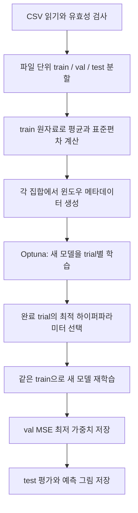
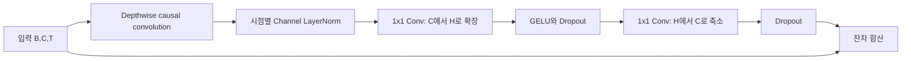

# BiLSTM·Causal ModernTCN 학습 코드 상세 리뷰 및 사용자 매뉴얼

작성일: 2026-10-19 (한국 시간)

대상: [py_BiLSTM_std.py](py_BiLSTM_std.py), [py_modernTCN_std.py](py_modernTCN_std.py)

분석 기준: Git 커밋 [`31988e9`](https://github.com/yangjunahn/lrf-sswu/commit/31988e994fe6d35e1308760700ecbd2e4f3ec647)의 두 최종 학습 코드

이론·기존 실험의 기준 문서: [LRF-SSWU-CodeDocumentation_Theory.pdf](LRF-SSWU-CodeDocumentation_Theory.pdf)

이 보고서는 학생이 정리한 최종 코드를 읽고 실행할 수 있도록 작성한 한국어 해설서다. PDF의 이론 설명을 코드의 클래스·함수·텐서 크기와 연결하고, 실제 구현의 장점과 결함, 환경 준비부터 저장 모델 추론까지의 절차를 설명한다. 원문 PDF를 별도로 준비하고 2절의 절·페이지 대응표를 이용해 함께 읽는다. **학습 소스는 수정하지 않았으며, 개선 코드는 제안으로 표시한다.**

PDF에 실린 수치는 기존 실험의 인용이다. 이번 보고서 작성에서는 합성 데이터로 축소 실행과 동작 검증을 수행했다. 실제 선박 데이터에 대한 40-trial 탐색과 최종 300-epoch 학습은 수행하지 않았으며, 그 성능을 새로 재현했다고 주장하지 않는다.

## 목차

1. [목표와 전체 실행 흐름](#1-목표와-전체-실행-흐름)
2. [PDF와 코드의 대응 관계](#2-pdf와-코드의-대응-관계)
3. [공통 설정과 데이터 처리 리뷰](#3-공통-설정과-데이터-처리-리뷰)
4. [BiLSTM 모델 상세 리뷰](#4-bilstm-모델-상세-리뷰)
5. [Causal ModernTCN 모델 상세 리뷰](#5-causal-moderntcn-모델-상세-리뷰)
6. [학습·탐색·재학습 리뷰](#6-학습탐색재학습-리뷰)
7. [평가·시각화·저장 결과 해석](#7-평가시각화저장-결과-해석)
8. [코드 리뷰 결과와 개선 우선순위](#8-코드-리뷰-결과와-개선-우선순위)
9. [환경 및 데이터 준비 매뉴얼](#9-환경-및-데이터-준비-매뉴얼)
10. [학습 실행·중단·재개 매뉴얼](#10-학습-실행중단재개-매뉴얼)
11. [저장된 모델로 새 데이터 예측하기](#11-저장된-모델로-새-데이터-예측하기)
12. [두 모델을 공정하게 비교하는 절차](#12-두-모델을-공정하게-비교하는-절차)
13. [오류 해결표](#13-오류-해결표)
14. [이번 보고서의 검증 범위와 참고자료](#14-이번-보고서의-검증-범위와-참고자료)

## 1. 목표와 전체 실행 흐름

두 코드는 관측된 선박의 6자유도 운동 128개 시점을 입력받아, 그 뒤 128개 시점의 6자유도 운동을 한 번에 예측한다. 입력과 정답은 모두 운동 데이터다. `Wave_` 파형 파일이나 파일명에 담긴 파고·파주기·선속을 모델의 별도 입력으로 사용하지 않는다.

| 항목 | 두 코드의 실제 설정 |
|---|---|
| 입력 / 출력 | `(B, 128, 6)` / `(B, 128, 6)` |
| 샘플링 주파수 | 2 Hz라고 가정, 간격 0.5초 |
| 입력 / 예측 길이 | 각각 128샘플, 관례적으로 64초 분량 |
| 윈도우 이동 | 16샘플, 8초 |
| 데이터 분할 | 파일을 섞어 test 약 15%, val 약 15%, 나머지 train |
| 학습 손실 | train 통계로 표준화한 공간의 MSE |
| 하이퍼파라미터 선택 | Optuna 완료 trial 중 최소 검증 MSE |
| 최종 모델 선택 | 새로 학습한 모델에서 최소 검증 MSE를 기록한 가중치 |
| 평가 | 표준화 공간 MSE·MAE, 원래 단위의 DOF별 RMSE |

128개 점의 첫 점부터 마지막 점까지의 간격은 63.5초다. 여기서 “64초 예측”은 마지막 입력 표본 다음의 0.5초부터 64초까지 128개 미래 표본을 예측한다는 의미다. 코드의 그림은 첫 정답 시점을 0초로 표시하므로, 그림 좌표와 마지막 관측 시점 기준의 예측 선행시간을 구분해야 한다.



코드가 출력하는 “전체 재학습”은 **train과 val을 합쳐 학습한다는 뜻이 아니다.** 탐색에서 얻은 설정으로 모델을 처음부터 다시 만들고, 기존 train으로 가중치를 학습하며 기존 val로 조기 종료한다. Test는 탐색과 가중치 갱신에 사용하지 않는다.

## 2. PDF와 코드의 대응 관계

PDF의 절 번호와 실제 PDF 페이지를 함께 적었다. 이론을 먼저 읽을 때는 아래 순서대로 코드와 대조하면 된다.

| PDF 위치 | 이론·설명 | 코드에서 확인할 부분 |
|---|---|---|
| §1–2, pp.1–2 | 다변량 다중 시점 예측, 6-DOF, 표본 간격 | 상단 설정, `dof_cols`, `dof_units` |
| §3, p.2 | 조건 분할, train 기반 z-score, 윈도우 | `load_id_data`, `make_window_meta`, `TimeWindowDataset`, main 전처리 |
| §4.1–4.4, pp.2–4 | 인과 합성곱, depthwise·pointwise, 잔차 연결 | ModernTCN의 `CausalConv1d`부터 `ModernTCNRegressor`까지 |
| §4.5, p.4, 그림 2 p.5 | BiLSTM 최종 상태 연결과 일괄 예측 | `SingleShotRNN.forward`, `create_model` |
| §5, p.5 | MSE, AdamW, clipping, scheduler, early stopping | `train_epoch`, `evaluate_epoch`, `build_optimizer_and_scheduler` |
| §6, pp.5–6 | TPE, pruning, 탐색 공간, DB 재개 | `sample_params`, `make_objective`, `run_study` |
| §7–8, pp.6–7 | 최종 재학습, 정규화 지표와 물리 RMSE | main의 학습·테스트 구간 |
| §9, pp.7–9 | 기존 최적 trial, 구조별 결과와 예측 사례 | 기존 실험 참고값. 현재 실행 결과는 결과 폴더에서 별도 확인 |

### 2.1 PDF의 기존 실험 결과

다음 값은 PDF §9의 표 8·10과 본문에서 인용했다. 모델 선택 시 참고할 수 있지만, 새로운 데이터·환경에서 보장되는 성능은 아니다.

| 항목 | Causal ModernTCN | BiLSTM |
|---|---|---|
| 기존 최적 trial | 38 | 26 |
| 탐색 단계의 best validation MSE | 0.428539 | 0.440436 |
| 주요 구조 | channels 128, blocks 4, kernel 55, expansion 2.0, stem kernel 3 | hidden_dim 64, n_layers 4 |
| Dropout | block 0.0, head 0.1 | LSTM 층 사이 0.0 |
| batch_size | 64 | 128 |
| 학습 가능 파라미터 | 313,094 | 433,920 |

위 구조의 파라미터 수는 현재 코드로 모델을 생성해 각각 확인했다. MSE 수치는 재측정하지 않았다. PDF에서 ModernTCN의 수치가 더 낮다는 사실만으로 테스트 성능의 우위나 통계적 유의성을 결론 내릴 수 없다. 특히 현재 `evaluate_epoch()`는 배치를 같은 비중으로 평균하므로, 서로 다른 batch size로 얻은 검증값에는 8.1절에서 설명하는 집계 문제도 고려해야 한다.

## 3. 공통 설정과 데이터 처리 리뷰

### 3.1 코드 위치와 함수 역할

표의 링크는 분석 대상 파일의 함수 시작 줄을 가리킨다.

| 역할 | BiLSTM | ModernTCN | 읽을 때 확인할 점 |
|---|---|---|---|
| 난수 초기화 | [L35](py_BiLSTM_std.py#L35) | [L35](py_modernTCN_std.py#L35) | Python·NumPy·PyTorch seed |
| CSV 로딩 | [L104](py_BiLSTM_std.py#L104) | [L103](py_modernTCN_std.py#L103) | `Wave_` 제외, 컬럼 fallback, 파일별 필터 |
| 윈도우 인덱스 | [L124](py_BiLSTM_std.py#L124) | [L123](py_modernTCN_std.py#L123) | 실제 데이터를 복사하지 않고 위치만 저장 |
| Dataset | [L134](py_BiLSTM_std.py#L134) | [L133](py_modernTCN_std.py#L133) | 입력·정답 슬라이스 후 동일 통계로 표준화 |
| DataLoader | [L154](py_BiLSTM_std.py#L154) | [L153](py_modernTCN_std.py#L153) | train만 shuffle·drop_last |
| 분할·통계·저장 | [main L563](py_BiLSTM_std.py#L563) | [main L601](py_modernTCN_std.py#L601) | test→val→train 배정, scaler 파일 작성 |

### 3.2 상단 설정값의 의미

`ID_DATA_DIR = Path("csv_dataset")`는 스크립트 파일 위치가 아니라 **실행한 작업 디렉터리**를 기준으로 해석된다. 결과 경로도 마찬가지다. 저장소 루트에서 실행하는 것이 가장 단순하다.

`IN_LEN`, `OUT_LEN`, `STRIDE`는 실제 슬라이스와 윈도우 수를 결정한다. 반면 `ID_HZ`와 `DT_SEC`는 그림의 시간축에 쓰인다. `ID_HZ`를 변경해도 원자료를 재표본화하거나 타임스탬프를 검사하지 않는다. 10 Hz 원자료에 2 Hz 설정을 그대로 적용하면 같은 행 개수라도 시간 해석이 달라진다.

`TRAIN_RATIO = 0.70`은 선언되지만 분할 계산에 직접 사용되지 않는다. 실제 train은 test와 val을 제외한 나머지다. Train 비율만 수정해서는 분할이 바뀌지 않는다.

### 3.3 `load_id_data()` — 파일 선별과 컬럼 처리

로딩 순서는 다음과 같다.

1. `data_dir.glob("*.csv")`로 해당 디렉터리 바로 아래 CSV를 찾고 파일명으로 정렬한다. 하위 폴더나 `.out` 파일은 읽지 않는다.
2. 파일명이 정확히 `Wave_`로 시작하면 제외한다. 대소문자를 구분한다.
3. `pd.read_csv(..., usecols=dof_cols)`로 여섯 컬럼을 읽는다.
4. `ValueError`가 발생하면 전체 CSV를 읽어 마지막 여섯 컬럼을 대신 사용한다.
5. `float32` 배열로 변환한다.
6. 길이가 `IN_LEN + OUT_LEN` 이상이고 배열 전체가 유한한 파일만 보관한다.

기본 설정에서는 최소 256행이 필요하다. 한 셀이라도 NaN·Inf가 있으면 해당 파일 전체를 제외한다. 결측치를 채우거나 유효 구간만 추출하지 않는다. 파일을 찾았어도 모두 무효라면 빈 배열 목록을 반환하고, 뒤의 train 결합에서 오류가 발생할 수 있다.

**컬럼 해석의 주의점:** `usecols`는 전달한 목록 순서대로 결과를 재정렬해 주는 장치가 아니다. CSV 헤더 자체가 `x1,x2,x3,x4,x5,x6` 순서인지 확인해야 한다. Fallback도 실제 마지막 여섯 컬럼이 운동값인지 검사하지 않는다. 시간이 섞이거나 단위·순서가 바뀌어도 여섯 숫자 열이면 학습이 진행될 수 있다. 매뉴얼에서는 명시적 헤더와 순서를 전제로 사전 검사를 제공한다.

| 컬럼 | 코드의 해석 | 표시·평가 단위 |
|---|---|---|
| x1 | Surge (X), 전후 운동 | m |
| x2 | Sway (Y), 좌우 운동 | m |
| x3 | Heave (Z), 상하 운동 | m |
| x4 | Roll, 횡동요 | deg |
| x5 | Pitch, 종동요 | deg |
| x6 | Yaw, 선수동요 | deg |

코드는 각도 단위를 변환하지 않는다. 입력이 rad이면 먼저 deg로 변환하거나, 데이터·메타데이터·그림 단위를 함께 변경해야 한다.

### 3.4 파일 단위 분할과 누수 방지

유효 파일 수를 $C$라 하면 다음을 계산한다.

$$
n_{test}=\max(1,\operatorname{round}(0.15C)),\qquad
n_{val}=\max(1,\operatorname{round}(0.15C)).
$$

파일 인덱스를 seed 42로 섞고 test, val, train 순으로 배정한다. Python의 `round`는 정확한 중간값에서 짝수 쪽으로 반올림하므로 항상 소수점 0.5를 올리는 규칙과 다를 수 있다. 분할 비율은 행 수나 윈도우 수가 아니라 파일 수 기준이다.

분할 이후 각 집합에서 윈도우를 만들기 때문에 같은 파일의 중첩 구간이 train과 test에 동시에 들어가지 않는다. Train 통계만 사용해 정규화한다는 점과 함께 이 코드의 중요한 장점이다. 다만 같은 물리 조건의 복제 파일·동일 시뮬레이션의 조각 파일이 서로 다른 이름으로 존재하면 이 방법만으로 조건 누수를 막지 못한다. 코드는 파일명의 heading·Tm·Hs·V를 해석하지 않으므로, “파일 단위 분리”가 물리적으로 독립된 조건 분리인지 확인해야 한다.

### 3.5 train 통계 기반 정규화

Train 파일의 모든 행을 결합해 DOF별 평균 $\mu_d$와 표준편차 $\sigma_d$를 구한다. NumPy 기본 표준편차, 즉 `ddof=0`을 사용한다.

$$
z_{t,d}=\frac{x_{t,d}-\mu_d}{\sigma_d},\qquad
x_{t,d}=z_{t,d}\sigma_d+\mu_d.
$$

`data_std == 0`인 값만 1로 바꾼다. 극도로 작은 양수 표준편차에 대한 하한은 없다. 파일 길이가 다르면 긴 파일이 통계에 더 큰 비중을 차지한다. 모든 원자료 배열뿐 아니라 `train_concat`도 메모리에 유지되므로, 윈도우 저장을 줄였더라도 데이터 전체를 스트리밍하는 구현은 아니다.

`scaler.json`에는 `dof_cols`, `mean`, `std`, `train_files`, `val_files`, `test_files`가 저장된다. 추론에는 학습 때의 통계를 그대로 사용해야 한다. 새 입력만으로 평균과 표준편차를 다시 구하면 학습 모델과 다른 좌표계가 된다.

### 3.6 `make_window_meta()`와 `TimeWindowDataset`

파일 길이가 $N$이고 이동 간격이 $S$라면 파일 하나의 윈도우 수는 다음과 같다.

$$
W(N)=\max\left(0,\left\lfloor\frac{N-L_{in}-L_{out}}{S}\right\rfloor+1\right).
$$

기본값에서 256행은 1개, 400행은 10개, 800행은 35개다. `meta`에는 `(file_idx, start_idx)`만 저장하고, `__getitem__()`이 요청 시 다음 구간을 잘라 표준화한다.

```python
x = raw_arr[start_idx:start_idx + 128]          # 과거 (128, 6)
y = raw_arr[start_idx + 128:start_idx + 256]    # 미래 (128, 6)
```

윈도우가 파일 경계를 넘지 않으며, 입력과 정답은 겹치지 않는다. 인접 윈도우끼리는 크게 겹친다. 학습 샘플을 확보하는 데 유용하지만 평가 표본들이 독립이라는 뜻은 아니다. 긴 파일은 윈도우도 많이 만들므로, 현재 손실과 RMSE는 조건마다 동일 비중을 주는 지표가 아니다.

### 3.7 `make_loaders()`

| 설정 | train | val / test |
|---|---|---|
| `shuffle` | `True` | `False` |
| `drop_last` | `True` | 기본 `False` |
| `pin_memory` | `True` | `True` |
| 기본 `num_workers` | 4 | 4 |

Train의 마지막 불완전 배치는 버린다. Train 윈도우가 batch size보다 적으면 DataLoader 길이가 0이 되어 `train_epoch()`의 나눗셈이 실패한다. 기본 탐색 후보의 최대 배치가 128이므로 사전 검사에서 train 윈도우가 128개 이상인지 확인하는 편이 안전하다. `num_workers=0`은 메모리나 프로세스 생성 문제가 있을 때 사용할 수 있다. `pin_memory=True`가 여러 GPU를 사용하도록 만드는 것은 아니다.

## 4. BiLSTM 모델 상세 리뷰

대상: [`SingleShotRNN`, L166–216](py_BiLSTM_std.py#L166), [`create_model`, L219–231](py_BiLSTM_std.py#L219). 이론 대응: PDF §4.5.

### 4.1 LSTM의 상태와 양방향 인코딩

LSTM은 입력 게이트·망각 게이트·출력 게이트와 셀 상태를 이용해 순차 정보를 갱신한다. 개념적으로 셀과 은닉 상태는 다음과 같이 표현된다.

$$
c_t=f_t\odot c_{t-1}+i_t\odot g_t,\qquad
h_t=o_t\odot\tanh(c_t).
$$

실제 게이트 계산은 `nn.LSTM`이 수행한다. 정방향은 입력 구간을 앞에서 뒤로, 역방향은 같은 관측 구간을 뒤에서 앞으로 처리한다. 두 방향 모두 이미 확보한 과거 128개 표본만 읽는다. 따라서 예측 시작 시점 이후의 정답을 인코더에 넣는 누수는 없다. 다만 입력 구간 내부의 모든 시점에서 과거 방향만 보도록 제한한 모델은 아니다.

`SingleShotRNN`은 GRU와 단방향도 지원하지만, 실제 `create_model()`은 **LSTM·bidirectional=True·6입력·6출력**을 고정한다. 이 스크립트를 실행하면 GRU를 탐색하는 것이 아니다.

### 4.2 텐서 흐름과 최종 상태 선택

| 단계 | 구현 | 크기 |
|---|---|---|
| 입력 | `batch_first=True` | `(B, 128, 6)` |
| LSTM의 최종 은닉 상태 | `h_n` | `(2L, B, H)` |
| 마지막 층 정방향 상태 | `h_n[-2]` | `(B, H)` |
| 마지막 층 역방향 상태 | `h_n[-1]` | `(B, H)` |
| 두 방향 연결 | `torch.cat(..., dim=-1)` | `(B, 2H)` |
| FC 출력 | `Linear(2H, 128*6)` | `(B, 768)` |
| 최종 예측 | `reshape` | `(B, 128, 6)` |

여기서 $L$은 층 수, $H$는 `hidden_dim`이다. 양방향 LSTM에서 `output[:, -1, :]`와 `h_n`의 최종 양방향 상태는 같은 의미가 아니다. 현재 구현은 두 방향의 최종 상태를 명시적으로 선택하므로 의도에 맞다. 셀 상태 `c_n`은 head에 전달하지 않는다. PyTorch의 상태·Dropout 정의는 [LSTM 공식 문서](https://docs.pytorch.org/docs/stable/generated/torch.nn.LSTM.html)에서도 확인할 수 있다.

### 4.3 Single-shot head와 Dropout

미래 128시점을 단일 선형층에서 생성한다. 별도 순환 decoder, teacher forcing, 이전 예측을 다음 입력으로 넣는 자기회귀 루프는 없다. 예측 오차가 자기회귀 입력을 거쳐 연쇄적으로 전파되는 경로가 없는 대신, 과거 전체를 `(B, 2H)`의 고정 길이 표현으로 압축한다.

Head에는 활성화와 Dropout이 없다. LSTM의 Dropout은 다층일 때 층 사이에만 적용되며 `n_layers=1`이면 0으로 고정된다. `sample_params()`도 단층에서는 Dropout을 샘플링하지 않는다. 이때 `study.best_params`에 `dropout` 키가 없을 수 있으나 `create_model()`과 `model_config.json` 작성에서 기본값 0.0을 처리한다.

`in_len`은 객체에 저장되지만 입력 길이를 검증하는 데 쓰이지 않는다. 반면 출력 길이는 FC 크기로 고정된다. 추론 시 임의의 길이를 넣을 수 있다는 사실이 다른 길이에서도 성능이 검증되었다는 뜻은 아니므로 학습과 같은 128개 입력을 사용한다.

### 4.4 파라미터 수와 모델 용량

입력 차원 $D=6$, 양방향, bias 사용, projection 없는 LSTM의 파라미터 수는 다음과 같이 계산할 수 있다.

$$
P=8H(D+H+2)+(L-1)8H(3H+2)+(2H+1)(6L_{out}).
$$

처음 두 항은 LSTM, 마지막 항은 FC다. PDF의 최적 구조 `H=64, L=4, L_out=128`은 433,920개다. 큰 hidden size와 깊은 층은 파라미터 수·학습 시간을 빠르게 늘린다. PDF에서도 더 큰 모델이 항상 더 낮은 검증 오차를 보이지 않았으므로, 파라미터 수와 검증 결과를 함께 확인한다.

## 5. Causal ModernTCN 모델 상세 리뷰

대상: [`L165–273`](py_modernTCN_std.py#L165). 이론 대응: PDF §4.1–4.4. 이 보고서의 “ModernTCN”은 이 저장소의 `Causal ModernTCN` 구현을 뜻한다. 일반적인 TCN의 확장 합성곱이나 다른 구현의 구성요소를 자동으로 포함한다고 해석하지 않는다.

### 5.1 전체 텐서 흐름

| 단계 | 코드 구성 | 출력 크기 |
|---|---|---|
| 입력 | 정규화한 운동 이력 | `(B, 128, 6)` |
| 채널 우선 변환 | `PermuteToChannelsFirst` | `(B, 6, 128)` |
| 입력 투영 | `CausalConv1d(6, C, stem_kernel_size)` | `(B, C, 128)` |
| 특징 추출 | `ModernTCNBlock` × `num_blocks` | `(B, C, 128)` |
| backbone 반환 | `PermuteToTimeFirst` | `(B, 128, C)` |
| 시간 투영 준비 | `transpose(1, 2)` | `(B, C, 128)` |
| 시간 투영 | `Linear(IN_LEN, OUT_LEN)` → GELU → Dropout | `(B, C, 128)` |
| 출력 투영 | 축 변환 → `Linear(C, 6)` | `(B, 128, 6)` |

클래스 생성자의 `out_len` 기본값은 64지만, 학습 스크립트의 `create_model()`은 전역 `OUT_LEN=128`을 명시적으로 전달한다. 현재 실험의 실제 예측 길이는 128이다. 추론에서 생성자를 기본값으로만 호출하면 이 차이를 놓칠 수 있다.

### 5.2 `CausalConv1d` — 왼쪽 패딩

커널 크기 $k$일 때 왼쪽에 $k-1$개의 0을 붙이고, `padding=0`인 `Conv1d`를 적용한다. Stride와 dilation은 모두 기본값 1이다. 출력 길이는 입력 길이와 같고, 시점 $t$의 특징은 $t$와 그 이전 표본에만 의존한다.

입력 구간 시작에는 실제 과거 대신 0이 쓰인다. 큰 커널과 깊은 층을 쓰면 이 패딩의 영향이 커질 수 있다. $N_b$개 block, block kernel $k$, stem kernel $k_s$인 backbone의 이론적 수용영역은 다음과 같다.

$$
R=k_s+N_b(k-1).
$$

PDF 최적 구조는 $R=3+4(55-1)=219$샘플이다. 이는 길이 128인 관측 구간보다 크다. 실제 사용 가능한 관측은 윈도우 내부에 한정되며 나머지는 패딩이다. 또한 최종 시간 투영 head가 모든 입력 위치를 결합하므로, 위 수용영역은 backbone의 위치별 특징에 대한 설명이다.

### 5.3 `ModernTCNBlock` — 시간 처리와 채널 혼합



`dwconv`는 `groups=channels`로 각 은닉 채널의 시간 패턴을 독립적으로 처리한다. 이 단계 자체에는 채널 혼합이 없다. 하지만 stem은 일반 합성곱으로 여섯 DOF를 이미 혼합한다. 따라서 은닉 채널 하나를 특정 물리 DOF 하나와 동일시할 수 없다.

`ChannelLayerNorm`은 `(B,C,T)`를 `(B,T,C)`로 바꾸어 같은 시점의 채널 축에 `LayerNorm(C)`를 적용한 뒤 복원한다. 시간 전체나 배치 전체를 묶어 통계를 내지 않으므로, 정규화가 뒤 시점의 값을 현재 시점에 섞지 않는다. Dataset의 z-score와는 다른, 학습 가능한 내부 정규화다.

`pwffn`은 커널 크기 1의 두 합성곱으로 같은 시점에서 채널을 혼합한다. 중간 폭은 `int(channels * expansion)`이다. GELU로 비선형성을 추가하고 Dropout을 두 번 적용한 후 원래 입력을 더한다. 잔차 연결이 가능한 이유는 모든 단계가 `(B,C,T)` 크기를 유지하기 때문이다.

### 5.4 시간 투영 head의 의미와 인과성 범위

`Linear(IN_LEN, OUT_LEN)`은 마지막 차원인 시간축에 작용한다. 각 은닉 채널에 같은 시간 변환 행렬을 적용하고, `output_projection`이 각 미래 위치의 채널을 여섯 DOF로 변환한다. BiLSTM처럼 하나의 최종 상태만 쓰지 않고 관측 구간의 위치별 특징을 head에 전달한다.

Backbone은 관측 구간 내부에서도 인과적이다. Head는 **예측 시점에 확보한 입력 구간 전체**를 사용한다. 이는 미래 정답의 누수는 아니지만, head까지 포함해 입력 구간의 각 위치가 자기 이전만 참조한다고 설명하면 부정확하다. 전체 모델 역시 미래 128시점을 한 번에 출력하며 자기회귀 예측을 하지 않는다.

### 5.5 파라미터 수

은닉 채널 $C$, 확장 폭 $H$, block 수 $N_b$에 대해 구성별 파라미터는 아래와 같다. 기본 bias와 LayerNorm affine을 포함한다.

| 구성 | 파라미터 수 |
|---|---|
| Stem | $6Ck_s+C$ |
| Block 하나 | $(Ck+C)+2C+(CH+H)+(HC+C)$ |
| 시간 투영 | $L_{in}L_{out}+L_{out}$ |
| 출력 투영 | $6C+6$ |

PDF 최적 구조는 합계 313,094개로 확인된다. 합성곱은 시간 위치의 연산을 병렬화할 수 있지만, 이 환경에서 실제 GPU 속도 비교를 수행하지 않았으므로 BiLSTM보다 몇 배 빠르다는 식의 주장은 할 수 없다.

## 6. 학습·탐색·재학습 리뷰

### 6.1 함수 지도

| 역할 | BiLSTM | ModernTCN |
|---|---|---|
| 가중치 학습 | [`train_epoch`, L240](py_BiLSTM_std.py#L240) | [`train_epoch`, L282](py_modernTCN_std.py#L282) |
| 검증·테스트 지표 | [`evaluate_epoch`, L256](py_BiLSTM_std.py#L256) | [`evaluate_epoch`, L298](py_modernTCN_std.py#L298) |
| AdamW·scheduler | [L267](py_BiLSTM_std.py#L267) | [L309](py_modernTCN_std.py#L309) |
| 탐색 공간 | [`sample_params`, L278](py_BiLSTM_std.py#L278) | [`sample_params`, L320](py_modernTCN_std.py#L320) |
| trial별 학습 | [`make_objective`, L298](py_BiLSTM_std.py#L298) | [`make_objective`, L338](py_modernTCN_std.py#L338) |
| 자원 정리 시도 | [`_cleanup`, L378](py_BiLSTM_std.py#L378) | [`_cleanup`, L418](py_modernTCN_std.py#L418) |
| DB와 요약 저장 | [`save_study_results`, L385](py_BiLSTM_std.py#L385) | [`save_study_results`, L425](py_modernTCN_std.py#L425) |
| trial 종료 callback | [`_save_callback`, L403](py_BiLSTM_std.py#L403) | [`_save_callback`, L443](py_modernTCN_std.py#L443) |
| study 구성·재개 | [`run_study`, L408](py_BiLSTM_std.py#L408) | [`run_study`, L448](py_modernTCN_std.py#L448) |
| 탐색 생략 시 로딩 | [`load_study_only`, L466](py_BiLSTM_std.py#L466) | [`load_study_only`, L504](py_modernTCN_std.py#L504) |
| 최종 재학습 진입 | [L637](py_BiLSTM_std.py#L637) | [L661](py_modernTCN_std.py#L661) |

### 6.2 손실과 한 epoch의 처리

각 배치에 대해 정규화 공간의 손실을 계산한다.

$$
\mathcal L=\frac{1}{B L_{out} 6}
\sum_{b,h,d}(\hat z_{b,h,d}-z_{b,h,d})^2.
$$

`train_epoch()`는 `model.train()` → 장치 이동 → gradient 초기화 → 예측 → MSE → 역전파 → gradient norm clipping → AdamW update 순으로 작동한다. Clipping의 `max_norm=1.0`은 전체 파라미터의 gradient norm에 적용된다. 각 gradient 값을 개별적으로 [-1,1]에 자르는 연산과 다르다.

표준화 공간에서 DOF를 같은 비중으로 평균한다는 것은 원래 단위의 제곱오차를 $1/\sigma_d^2$로 가중한 것과 같다. m와 deg의 수치 크기를 직접 섞는 문제를 줄이지만, 모든 DOF의 물리 오차를 같은 수치만큼 줄이는 목적은 아니다.

`evaluate_epoch()`는 `model.eval()`과 `torch.no_grad()`로 가중치 갱신과 Dropout을 끄고 MSE·MAE를 계산한다. Train 손실은 가중치가 변하는 중, Dropout이 켜진 상태의 값이다. 따라서 val 손실이 train 손실보다 낮다는 사실 하나만으로 누수를 단정할 수 없다. 반환되는 epoch 지표의 배치 평균 문제는 8.1절을 참고한다.

### 6.3 AdamW·학습률 감소·조기 종료

두 코드 모두 `AdamW(lr=learning_rate, weight_decay=weight_decay)`를 사용한다. `ReduceLROnPlateau(mode="min", factor=0.5, patience=3)`는 검증 손실을 받아 필요할 때 학습률을 절반으로 줄인다. Scheduler 내부의 개선 판정과 수동 조기 종료의 `val_loss < best_val` 판정은 완전히 같은 기준이 아니다.

조기 종료는 개선이 없는 epoch가 연속 10회이면 작동한다. 미세한 개선도 개선으로 인정하며, 별도 `min_delta`는 없다. Trial당 최대 40 epoch, 최종 재학습 최대 300 epoch다. `history["lr"]`는 해당 epoch의 검증 후 scheduler가 갱신한 학습률이므로, 그 epoch의 모든 배치가 이 값으로 학습되었다고 해석하면 안 된다.

### 6.4 탐색 공간

| BiLSTM 항목 | 후보 / 범위 |
|---|---|
| `hidden_dim` | 64, 128, 256, 512 |
| `n_layers` | 정수 1–8 |
| `dropout` | 다층일 때만 0.00–0.30, 간격 0.05; 단층은 0 |
| `learning_rate` | $10^{-4}$–$5\times10^{-3}$, log 탐색 |
| `weight_decay` | $10^{-5}$–$10^{-2}$, log 탐색 |
| `batch_size` | 32, 64, 128 |

| ModernTCN 항목 | 후보 / 범위 |
|---|---|
| `channels` | 64, 96, 128, 192, 256 |
| `num_blocks` | 정수 2–8 |
| `kernel_size` | 7, 15, 23, 31, 39, 47, 55, 63 |
| `expansion` | 1.0, 2.0, 3.0, 4.0 |
| `dropout`, `head_dropout` | 각각 0.00–0.30, 간격 0.05 |
| `stem_kernel_size` | 3, 5, 7, 11, 15, 21 |
| `learning_rate`, `weight_decay`, `batch_size` | BiLSTM과 동일 |

`count_parameters()`는 `requires_grad=True`인 파라미터를 합산해 `trial.user_attrs["n_params"]`에 기록한다. 성능과 용량의 관계를 분석할 때 유용하다. 모델 크기를 목적함수에서 벌점으로 쓰지는 않는다.

### 6.5 trial과 study의 동작

매 trial은 seed를 42로 초기화하고 새 모델·optimizer·loader를 만든다. `trial.report(val_loss, step=epoch)`로 중간값을 기록하고, trial 안의 최저 검증값을 추적한다. 반환하는 목적값은 **마지막 epoch의 손실이 아닌 해당 trial의 최소 검증 MSE**다. `epochs_done`, `best_val_so_far`, `n_params`를 기록하지만 trial의 모델 가중치는 저장하지 않는다.

`TPESampler(seed=42, n_startup_trials=8)`는 초기 탐색 후 기존 평가를 이용해 후보를 제안한다. `MedianPruner(n_startup_trials=8, n_warmup_steps=8)`는 다른 완료 trial의 중간 성능을 참고해 유망하지 않은 trial을 일찍 끝낸다. Step을 1부터 보고하므로 단순히 “처음 8 epoch가 모두 면제된다”고 고정해서 이해하지 말고 설정값과 라이브러리 경계 조건을 확인해야 한다. 현재 검증 환경의 정의는 [Optuna 4.5.0 MedianPruner 문서](https://optuna.readthedocs.io/en/v4.5.0/reference/generated/optuna.pruners.MedianPruner.html)를 따른다.

Pruning 판정을 먼저, 같은 trial의 정체에 따른 조기 종료를 다음에 수행한다. 검증 손실이 NaN·Inf이면 pruning 처리하지만, CUDA 메모리 부족 등 일반 실행 예외를 잡아 다음 trial로 넘어가는 처리는 없다.

Study는 `EXP_NAME`이라는 이름과 SQLite DB 경로로 식별된다. `load_if_exists=True`이므로 기존 DB가 있으면 과거 trial을 다시 사용한다. 추가 trial 수는 다음과 같다.

```python
n_done = sum(t.state != optuna.trial.TrialState.RUNNING for t in study.trials)
n_remaining = max(0, OPTUNA_CONFIG["n_trials"] - n_done)
```

따라서 40회는 완료 trial 40개를 보장하지 않는다. PRUNED·FAIL도 예산에 포함되고, 비정상 종료로 남은 RUNNING trial은 제외된다. RUNNING trial의 가중치나 epoch를 이어 학습하지도 않는다. 재개 때 sampler를 seed 42로 다시 생성하므로, DB 재개가 중단 없는 TPE 제안 순서까지 복원하는 기능은 아니다.

### 6.6 최종 재학습과 체크포인트

완료 trial이 하나 이상이어야 `study.best_params`를 사용할 수 있다. 선택한 설정으로 seed를 다시 초기화하고 새 모델을 최대 300 epoch 학습한다. 매번 `val_loss < best_val_loss`일 때 `model.state_dict()`를 덮어 저장한다. 최적 trial의 가중치를 이어받는 방식이 아니다.

최종 재학습은 원래 train만 사용하고 val을 유지한다. 종료 후 best 가중치를 다시 불러와 test를 평가한다. 탐색의 `best_value`와 최종 `final_best_val_mse`는 학습 예산과 실행 단계가 다른 값이므로 구별해야 한다.

저장하는 것은 가중치다. Optimizer·scheduler·현재 epoch·난수 상태를 포함한 학습 재개용 checkpoint는 없다. 최종 학습 중단 후 `skip_search=True`로 실행하면 **최종 학습을 처음부터 다시 시작한다.**

## 7. 평가·시각화·저장 결과 해석

### 7.1 표준화 공간의 MSE·MAE

`test_mse_zscore`와 `test_mae_zscore`는 모든 예측 위치와 DOF를 섞어 계산한 무차원 값이다. 8.1절의 집계 방식을 제외하면 배치 내부의 MSE는 6.2절 식, MAE는 절댓값 오차의 평균이다. `test_mse_zscore`에 제곱근을 씌운 값과 물리 단위의 각 DOF RMSE는 서로 다른 지표다.

### 7.2 물리 단위의 DOF별 RMSE

예측과 정답에 같은 평균을 사용했으므로 오차를 역변환할 때 평균은 소거된다.

$$
e_{b,h,d}^{phys}=(\hat z_{b,h,d}-z_{b,h,d})\sigma_d,
\qquad
\operatorname{RMSE}_d=\sqrt{\frac{\sum_{b,h}(e_{b,h,d}^{phys})^2}{N_{test}L_{out}}}.
$$

여기서 $N_{test}$는 테스트 윈도우 수다. 실제 코드는 각 배치에서 제곱오차의 **합**을 누적하고 전체 윈도우×예측 길이로 나누므로, 이 지표에는 `evaluate_epoch()`의 동일 배치 가중치 문제가 없다. 다만 서로 겹치는 윈도우에서 같은 시점이 여러 예측 위치로 다시 평가된다. 이는 윈도우 기반 예측 실험의 점수이지 고유 원시 시점마다 한 번씩 센 점수는 아니다.

Surge·Sway·Heave는 m, Roll·Pitch·Yaw는 deg다. 단위가 다른 여섯 RMSE를 단순 합산해 하나의 물리적 오차라고 해석하지 않는다. 코드에는 선행시간별 RMSE, 조건별 동일 가중치 RMSE, 예측구간·불확실성 추정이 구현되어 있지 않다.

### 7.3 그림을 읽는 방법

| 함수 / 그림 | 실제 동작과 해석 |
|---|---|
| `plot_study()` | `optuna_history.png`, `optuna_param_importance.png`; 그림 생성 오류는 출력 후 건너뜀 |
| `plot_training_curves()` | train·val MSE와 best epoch를 표시. 내부 x좌표는 0부터, best epoch 라벨은 1부터 계산 |
| `plot_test_predictions()` | 테스트 Dataset 인덱스 전역에서 `linspace`로 최대 4개 선택. 무작위·최우수 사례 선택이 아님 |
| `test_pred_<파일 stem>_start<행>.png` | 3×2 패널에 회색 과거, 녹색 정답, 빨간 예측을 원래 단위로 표시. 500 dpi |

테스트 예시 4장이 모든 조건이나 오차의 분포를 대표하지는 않는다. 시간축은 과거 `-64, -63.5, …, -0.5`, 미래 `0, 0.5, …, 63.5`초다. 실제 마지막 관측을 기준으로 선행시간을 보고하려면 미래 축에 0.5초를 더해 해석한다.

파라미터 중요도 그림은 완료 trial 수가 너무 적거나, 환경에 필요한 라이브러리가 없거나, 값이 변하지 않는 탐색이면 생성되지 않을 수 있다. 현재 검증 환경인 Optuna 4.5.0의 기본 fANOVA 중요도는 scikit-learn을 사용한다. [해당 버전의 공식 문서](https://optuna.readthedocs.io/en/v4.5.0/reference/generated/optuna.importance.FanovaImportanceEvaluator.html). BiLSTM의 조건부 `dropout`처럼 일부 trial에 없는 파라미터는 기본 중요도 분석에서 빠질 수 있다.

### 7.4 결과 폴더와 파일

기본 결과 경로는 다음과 같다. `experiments0917`·`experiments0904`는 소스에 고정된 폴더 이름이며 현재 실행 날짜를 뜻하지 않는다.

```text
experiments0917/BiLSTM_SingleShot_optuna_in128_out128_stride16/
experiments0904/CausalModernTCN_optuna_in128_out128_stride16/
```

각 실험 폴더의 파일 의미는 다음과 같다.

| 파일 | 내용 | 생성 시점 / 주의점 |
|---|---|---|
| `models/best_model.pt` | 최종 재학습 중 best val의 state_dict | 탐색 trial의 가중치가 아님 |
| `scaler.json` | 6개 평균·표준편차와 train/val/test 파일 목록 | DB 로딩보다 먼저 작성·덮어씀 |
| `model_config.json` | 입력·출력 차원, 길이, LSTM 구조 | **BiLSTM에만 있음** |
| `optuna_study.db` | trial 설정·목적값·중간값·속성 | study 재개에 사용. 가중치 미포함 |
| `optuna_trials.csv` | trial 테이블 | trial 종료 callback 등에서 갱신 |
| `best_params.json` | best trial 설정과 요약, 완료 후 test 지표 병합 | 재실행 시 탐색 요약 저장이 이전 test 지표를 지울 수 있음 |
| `history.json` | `train_loss`, `val_loss`, `val_mae`, `lr` 목록 | 최종 재학습 루프가 끝난 뒤 저장 |
| `plots/optuna_history.png` | 탐색 이력 | 시각화 성공 시 |
| `plots/optuna_param_importance.png` | 파라미터 중요도 | 시각화 성공 시 |
| `plots/training_curves.png` | 최종 재학습 손실 곡선 | 최종 재학습 종료 후 |
| `plots/test_pred_*.png` | 최대 4개 예측 사례 | 테스트 평가 후 |

`best_params.json`의 주요 키는 아래처럼 구별한다.

```text
n_trials_total / n_trials_complete  전체 기록 수 / 완료 수
best_trial / best_value            탐색 단계에서 선택된 trial / 그 최저 val MSE
best_params                       구조·optimizer·batch 설정
final_best_val_mse                 최종 재학습의 최저 val MSE
test_mse_zscore / test_mae_zscore   최종 모델의 테스트 표준화 지표
test_rmse_per_dof                  원래 단위의 6개 DOF RMSE
```

## 8. 코드 리뷰 결과와 개선 우선순위

아래 항목은 현재 구현의 검토 결과다. “높음”은 정상 실행이나 실험 해석을 바꿀 수 있다는 뜻이며, 모든 입력에서 즉시 실패한다는 의미는 아니다. 원본 코드를 고치지 않고 문서에 수정 방향을 제안한다.

| 번호 | 우선순위 | 문제 | 영향과 우선 조치 |
|---|---|---|---|
| R1 | 높음 | 검증·테스트 MSE/MAE가 배치별 단순 평균 | trial 순위까지 영향 가능. 전체 원소 수로 가중 집계 |
| R2 | 높음 | ModernTCN은 과거 모든 trial의 `interrupted`를 검사 | 재개 완료 후에도 최종 학습 생략 가능. 이번 실행의 trial만 검사 |
| R3 | 높음 | study에 데이터·전처리 식별 정보가 없음 | 과거 성능과 새 데이터를 혼합. 실험명·DB 분리와 manifest 보존 |
| R4 | 높음 | CSV 순서·fallback의 의미를 보장하지 않음 | DOF 혼동·잘못된 입력. 명시적 컬럼 재정렬과 단위 검사 |
| R5 | 높음 | 빈 train/loader와 배치 크기 검사가 없음 | `concatenate`·0 나눗셈 실패. 파일·윈도우 수 사전 검사 |
| R6 | 중간 | ModernTCN `skip_search`는 요약 JSON을 재생성하지 않음 | DB만 복구한 경우 학습 후 JSON 읽기 실패 가능. 재학습 전 요약 저장 |
| R7 | 중간 | `_cleanup()`이 호출자 참조를 해제하지 않음 | GPU 자원 정리 의도와 실제 수명 차이. 참조 해제 위치 개선 |
| R8 | 중간 | 중간 학습 상태 미저장·일반 예외 처리 부족 | 재시작 비용, OOM 시 탐색 중단. checkpoint·예외 정책 추가 |
| R9 | 중간 | 출력 경로 재사용과 요약 덮어쓰기 | scaler·가중치·JSON 불일치, 이전 지표 손실. 실행별 폴더 보존 |
| R10 | 중간 | seed만으로 전체 재현성을 보장하지 못함 | 버전·장치·재개 방식 기록, 반복 seed 평가 |
| R11 | 보완 | 파일별·선행시간별 평가와 시간·단위 검증이 없음 | 데이터 및 일반화 해석 범위 명시, 추가 지표 설계 |

### 8.1 R1 — 배치 평균을 다시 평균하는 문제

위치: [BiLSTM `evaluate_epoch`](py_BiLSTM_std.py#L256), [ModernTCN `evaluate_epoch`](py_modernTCN_std.py#L298).

현재 구현은 배치마다 평균 MSE·MAE를 구한 뒤 배치 개수로 나눈다. 마지막 배치가 작으면 그 표본에 더 큰 가중치가 부여된다. Batch size가 탐색 대상이므로 이 문제는 최종 보고 지표뿐 아니라 최적 trial 선택과 scheduler·조기 종료에도 영향을 줄 수 있다.

재현 예: 33개 윈도우에서 처음 32개의 모든 오차가 0, 마지막 1개의 모든 오차가 10이고 batch size가 32인 경우다.

| 지표 | 현재 함수 | 전체 원소 기준의 올바른 집계 |
|---|---|---|
| MSE | `(0 + 100) / 2 = 50` | `100 / 33 ≈ 3.030303` |
| MAE | `(0 + 10) / 2 = 5` | `10 / 33 ≈ 0.303030` |

위 차이는 두 코드의 실제 `evaluate_epoch()`를 사용해 재현했다. 모든 배치가 같은 크기이면 이 차이는 사라진다. Train은 `drop_last=True`라 배치 크기가 같지만, 버린 윈도우까지 포함한 전체 train 점수는 아니다.

**수정 제안:** 현재 MSE 기준의 평가 함수를 아래처럼 원소 합으로 계산한다. 이것은 보고서의 제안이며 원본에 적용하지 않았다.

```python
@torch.no_grad()
def evaluate_epoch(model, loader, criterion, show_bar=True):
    model.eval()
    squared_sum, absolute_sum, count = 0.0, 0.0, 0
    for src, trg in tqdm(loader, desc="Eval", leave=False, disable=not show_bar):
        src, trg = src.to(device), trg.to(device)
        error = model(src) - trg
        squared_sum += error.square().sum().item()
        absolute_sum += error.abs().sum().item()
        count += trg.numel()
    if count == 0:
        raise RuntimeError("평가할 원소가 없습니다.")
    return squared_sum / count, absolute_sum / count
```

지표 집계를 바꾼 뒤에는 이전 DB의 목적값과 섞지 말고 새 study로 탐색한다. 기존 best 가중치를 다시 평가할 수는 있지만, 수정된 지표로 탐색했을 때도 같은 trial이 최적이라는 보장은 없다.

### 8.2 R2 — ModernTCN의 과거 중단 기록

위치: [ModernTCN L484](py_modernTCN_std.py#L484), 비교: [BiLSTM L432](py_BiLSTM_std.py#L432).

ModernTCN은 DB의 어떤 trial이든 `user_attrs["interrupted"]`가 있으면 현재 실행도 `interrupted=True`로 판단한다. 과거 Ctrl+C가 한 번 기록되면, 나중 실행에서 탐색을 마쳤어도 기본 `train_after_interrupt=False` 때문에 최종 재학습을 계속 건너뛸 수 있다. 이미 예산을 채워 새 trial을 실행하지 않아도 같다.

BiLSTM은 실행 전에 `previous_numbers`를 저장하고 **이번 실행에서 생긴 trial만** 검사하므로 이 문제를 피한다. 과거 중단 trial 하나가 있는 가짜 study를 사용한 검증에서 BiLSTM은 False, ModernTCN은 True를 반환하는 것을 확인했다. 실제 사용자 키보드 신호를 보내는 테스트는 수행하지 않았다.

**원본을 유지하는 실행 우회:** 완료 trial이 있는 DB에서 `skip_search=True`로 두면 `load_study_only(), False` 분기를 통해 최종 재학습으로 진입한다. DB 예산을 더 채운 뒤 최종 학습까지 진행하려는 경우에는 기존 기록과 현재 실행 상황을 확인하고 `train_after_interrupt=True`를 사용할 수 있다. 후자는 현재 실행을 중단해도 학습을 진행하도록 바꾸는 옵션이다.

**수정 제안:** BiLSTM과 동일하게 `study.optimize()` 전후의 trial 번호를 비교해 이번 실행에서 중단된 trial만 검사한다.

### 8.3 R3·R9 — 실험 식별과 산출물 보존

기본 `EXP_NAME`에는 모델명·입력 길이·출력 길이·stride만 들어간다. 데이터 내용, seed, 분할 비율, 정규화·지표 구현을 바꿔도 이름은 같을 수 있다. 그 상태로 같은 결과 폴더를 사용하면 과거 trial과 새로운 실행을 혼합한다.

더구나 main은 **기존 DB나 가중치의 호환성을 확인하기 전에** 현재 데이터로 `scaler.json`을 덮어쓴다. 기존 best 가중치는 남았는데 scaler만 새 데이터 것으로 바뀌면 추론이 잘못될 수 있다. `save_study_results()`는 JSON을 새 payload로 쓰므로, 기존 test 지표가 재실행 중 사라질 수도 있다.

운영 시 데이터·분할·지표·코드를 바꾸면 새 `EXP_NAME`과 결과 경로를 사용하고, 완료된 폴더를 통째로 보존한다. 개선 시에는 데이터 파일 해시·코드 커밋·환경 버전·설정·분할 해시를 manifest로 저장하고 기존 study와 대조하도록 한다. 최종 test 지표도 별도 `metrics.json`으로 분리하면 재개 과정에서 덮어쓰지 않을 수 있다.

### 8.4 R4·R5 — 입력 검증과 작은 데이터

컬럼명이 있다고 가정한 뒤 마지막 여섯 컬럼으로 조용히 대체하는 방식은 사용자 편의와 오해 가능성이 함께 있다. 개선 시 `df.loc[:, dof_cols]`로 순서를 고정하고, 누락 컬럼은 구체적 오류로 알리는 편이 낫다. 부득이한 fallback은 명시적 옵션으로 두고 실제 매핑을 저장한다.

최소 3개 유효 파일이 있어야 train·val·test에 각각 한 파일을 둘 수 있다. 그러나 3개가 있다는 사실만으로 학습이 가능하지는 않다. Train 윈도우 합이 후보 batch size보다 작으면 0개 배치가 된다. `STRIDE > 0`, 유효 6열, 비어 있지 않은 세 집합, 충분한 train 윈도우를 확인해야 한다. 지나치게 작은 표준편차와 전체가 무효인 파일 목록에 대한 오류 메시지도 보완할 수 있다.

### 8.5 R6 — DB만 있는 ModernTCN의 탐색 생략

`load_study_only()`는 study를 반환하지만 `best_params.json`을 작성하지 않는다. BiLSTM main은 재학습 전에 `save_study_results(study)`를 호출한다. ModernTCN main에는 이 호출이 없다. 정상 탐색 후 JSON이 함께 남아 있으면 문제가 없지만, SQLite만 복구해 `skip_search=True`로 실행하면 긴 재학습을 마친 뒤 테스트 결과를 병합하려고 JSON을 읽는 곳에서 실패할 수 있다.

실행 전 결과 폴더에 DB와 `best_params.json`이 모두 있는지 확인한다. 개선 시 재학습 진입 전에 summary를 생성하고, 최종 지표를 메모리에서 구성해 저장하도록 변경한다.

### 8.6 R7·R8 — 자원 정리·중단·예외 처리

`_cleanup(*objs)`의 `del o`는 루프의 지역 변수만 지운다. `objs` 튜플과 호출자 변수는 여전히 모델·optimizer를 참조한다. `torch.cuda.empty_cache()`도 살아 있는 텐서를 해제하지 않는다. `gc_after_trial=True`와 함수 반환 후 수명 종료가 별도로 작용하지만, `_cleanup()` 자체를 즉시 GPU 모델을 삭제하는 함수로 설명하면 부정확하다. 개선 시 호출자 범위에서 참조를 해제하고 `try/finally`로 자원 정리를 보장한다.

Ctrl+C는 objective의 학습 `try` 내부에서 처리한다. 완료 epoch가 있고 `finish_partial_trial=True`이면 그때까지의 best 값을 반환해 COMPLETE로 기록하고 study를 중지한다. 이 trial은 다른 trial보다 적게 학습했을 수 있으므로 `interrupted`, `epochs_done`을 함께 읽어야 한다. 모델 생성 중·최종 학습 중 신호나 강제 종료까지 모두 같은 방식으로 처리하는 것은 아니다. 최종 학습의 `history.json`은 루프 종료 후 쓰므로 중단 시 최신 이력이 남지 않을 수 있다.

CUDA OOM을 포함한 일반 예외가 발생하면 현재 설정으로는 탐색 전체가 중단될 수 있다. 개선 시 메모리 예산에 맞는 탐색 범위를 정하고, 예상 가능한 예외를 어떻게 trial 실패·pruning으로 처리할지 명시한다. 재개 checkpoint에는 optimizer·scheduler·epoch·best 값·난수 상태도 저장해야 한다.

### 8.7 R10·R11 — 재현성과 실험 해석

Seed 42는 Python·NumPy·PyTorch에 적용되지만 deterministic algorithm 설정, 환경 잠금, 데이터 해시, sampler 상태의 완전한 복원까지 포함하지는 않는다. 동일 seed가 서로 다른 구조에 같은 초기 가중치나 Dropout 난수열을 부여하는 것도 아니다. 최종 결론은 여러 seed에서 확인한다.

코드는 타임스탬프 간격, 결측 시간, 센서 단위, 동일 물리 조건의 그룹, 외삽 조건 여부를 검증하지 않는다. 파일 분할 test를 “실제 운항 환경에서 검증된 일반화 성능”으로 확대해 설명하지 않는다. 선행시간별·조건별 지표, 비교 기준 모델, 반복 실험은 후속 분석에서 추가할 수 있다.

## 9. 환경 및 데이터 준비 매뉴얼

### 9.1 준비할 것과 실행 환경

필수 준비물은 두 학습 소스, Python 환경, 실제 2 Hz로 정렬된 운동 CSV다. PDF는 이론·구조·기존 결과를 이해하기 위한 참조 자료이며 프로그램이 읽는 입력 파일은 아니다. 여기서는 Linux/bash를 기준으로 설명한다.

이번 축소 실행을 확인한 환경은 다음과 같다. 학생의 원 실험 환경을 의미하지 않으며, 다른 모든 버전 조합을 검증한 것도 아니다.

| 구성 | 검증 환경 |
|---|---|
| Python | 3.10.12 |
| PyTorch | 2.5.1+cu124, 실행은 CPU |
| NumPy / pandas | 2.2.6 / 2.2.3 |
| Matplotlib / tqdm | 3.10.0 / 4.67.1 |
| Optuna / scikit-learn | 4.5.0 / 1.7.0 |

NVIDIA GPU가 보이면 `cuda:0`, 아니면 CPU를 사용한다. MPS 자동 선택·멀티 GPU 학습·분산 학습·혼합 정밀도 학습은 구현되어 있지 않다.

### 9.2 저장소와 가상환경 준비

이미 저장소가 있으면 해당 디렉터리에서 가상환경 준비부터 진행한다. 아래 `python3.10`은 Python 3.10 실행 파일이 설치되어 있다는 전제다.

```bash
git clone https://github.com/yangjunahn/lrf-sswu.git
cd lrf-sswu
python3.10 -m venv .venv
source .venv/bin/activate
python -m pip install --upgrade pip
```

GPU를 쓰지 않는 Linux 환경에서 위 검증 버전에 맞추는 설치 예시는 다음과 같다. CPU wheel을 새 가상환경에 설치하는 예시이며 이 보고서에서 새로 설치까지 검증한 것은 아니다.

```bash
python -m pip install torch==2.5.1 --index-url https://download.pytorch.org/whl/cpu
python -m pip install numpy==2.2.6 pandas==2.2.3 matplotlib==3.10.0 tqdm==4.67.1 optuna==4.5.0 scikit-learn==1.7.0
```

CUDA 환경은 GPU·드라이버에 맞는 PyTorch build를 [공식 설치 안내](https://pytorch.org/get-started/locally/)에서 선택한다. 이미 정상 구성된 GPU 환경에 CPU 설치 명령을 덮어 실행하지 않는다. 이 코드에는 torchvision·torchaudio가 필요하지 않다.

설치를 확인한다.

```bash
python - <<'PY'
import sys
import numpy, pandas, matplotlib, tqdm, optuna, sklearn, torch
print("Python:", sys.version.split()[0])
print("PyTorch:", torch.__version__)
print("CUDA build:", torch.version.cuda)
print("CUDA available:", torch.cuda.is_available())
print("Optuna:", optuna.__version__)
if torch.cuda.is_available():
    print("GPU:", torch.cuda.get_device_name(0))
PY
```

`CUDA build`가 있어도 `CUDA available=False`이면 현재 프로세스에서는 CPU를 사용한다. 보고서 작성 환경도 이 경우에 해당했다.

### 9.3 CSV 배치와 시간·단위 확인

기본 디렉터리 예시는 다음과 같다. 아래 파일명과 행은 형식 설명을 위한 예시이며 실험 데이터가 아니다.

```text
lrf-sswu/
├── py_BiLSTM_std.py
├── py_modernTCN_std.py
├── csv_dataset/
│   ├── condition_001.csv
│   ├── condition_002.csv
│   ├── ...
│   └── Wave_condition_001.csv   # 코드가 제외하는 파형 파일
└── LRF-SSWU-CodeDocumentation_Theory.pdf
```

```csv
time,x1,x2,x3,x4,x5,x6
0.0,0.01,0.02,0.03,0.10,0.20,0.30
0.5,0.02,0.03,0.04,0.11,0.21,0.31
```

시간 컬럼은 모델에 전달되지 않는다. 시간 오름차순, 간격 0.5초, 연속성, 원점·단위·좌표계의 일관성을 원자료에서 확인한다. 최소 256행이 필요하며 NaN·Inf가 없어야 한다. CSV 내부의 `x1`부터 `x6`까지의 순서를 유지한다. 첫 행은 컬럼명이어야 한다.

작성 시점의 작업공간에는 `csv_dataset`이 없었다. 저장소의 `dataset`·`dataset_grid` 등의 폴더가 곧바로 같은 형식·주파수의 입력이라고 가정하지 않는다. 실제 검증한 데이터가 다른 경로에 있으면 **두 소스의** `ID_DATA_DIR`을 그 경로로 수정하거나 기본 경로에 데이터를 준비한다. 전처리·재표본화가 필요하면 별도로 수행하고 그 과정을 기록한다.

### 9.4 실행 전 검사

아래 블록을 저장소 루트에서 실행한다. 학습 코드를 import하지 않고 파일 형식·유효 길이·분할·윈도우 수를 검사한다. 안전을 위해 원본의 fallback보다 엄격하게 컬럼을 확인한다. `data_dir`과 길이·비율은 실제 수정한 학습 설정과 일치시킨다.

```bash
python - <<'PY'
from pathlib import Path
import numpy as np
import pandas as pd

data_dir = Path("csv_dataset")
cols = ["x1", "x2", "x3", "x4", "x5", "x6"]
in_len, out_len, stride = 128, 128, 16
val_ratio, test_ratio = 0.15, 0.15
assert stride > 0
files = sorted(p for p in data_dir.glob("*.csv") if not p.name.startswith("Wave_"))
if not files:
    raise SystemExit(f"CSV가 없습니다: {data_dir.resolve()}")
valid, schema_errors = [], []
for path in files:
    try:
        df = pd.read_csv(path)
        if [c for c in df.columns if c in cols] != cols:
            raise ValueError("x1~x6 누락 또는 순서 불일치")
        arr = df.loc[:, cols].to_numpy(dtype=np.float32)
    except (ValueError, TypeError, pd.errors.ParserError) as exc:
        schema_errors.append(f"{path.name}: {exc}")
        continue
    if len(arr) < in_len + out_len or not np.isfinite(arr).all():
        print("제외될 파일:", path.name, "행 수:", len(arr))
        continue
    windows = (len(arr) - in_len - out_len) // stride + 1
    valid.append((path.name, windows))
if schema_errors:
    raise SystemExit("컬럼/수치 형식 수정 필요:\n" + "\n".join(schema_errors))
if len(valid) < 3:
    raise SystemExit("유효 파일이 최소 3개 필요합니다.")
indices = np.arange(len(valid))
np.random.RandomState(42).shuffle(indices)
n_test = max(1, int(round(len(valid) * test_ratio)))
n_val = max(1, int(round(len(valid) * val_ratio)))
splits = {
    "train": indices[n_test + n_val:],
    "val": indices[n_test:n_test + n_val],
    "test": indices[:n_test],
}
counts = {}
for name, ids in splits.items():
    counts[name] = sum(valid[i][1] for i in ids)
    print(name, "파일:", len(ids), "윈도우:", counts[name])
if any(counts[k] == 0 for k in counts):
    raise SystemExit("빈 데이터 집합이 있습니다.")
if counts["train"] < 128:
    raise SystemExit("기본 탐색의 batch_size=128보다 train 윈도우가 적습니다. 데이터/배치 후보를 조정하세요.")
print("형식·윈도우 사전 검사 통과. 주파수·단위·조건 독립성은 원자료에서 별도 확인하세요.")
PY
```

## 10. 학습 실행·중단·재개 매뉴얼

### 10.1 실행 전 설정 점검

스크립트에 CLI argument parser가 없으므로 `--epochs`, `--batch-size`, `--skip-search` 같은 옵션은 제공되지 않는다. 파일 상단의 설정과 `sample_params()`를 편집한다. 두 모델을 비교할 때 데이터·입출력 길이·stride·분할 비율·seed를 일치시킨다.

| 변경 목적 | 수정할 곳 | 주의 |
|---|---|---|
| 데이터 경로 | `ID_DATA_DIR` | 실제 2 Hz 운동 데이터인지 확인 |
| 관측·예측 길이 | `IN_LEN`, `OUT_LEN` | 새 실험명·가중치·scaler 사용 |
| 윈도우 수 조절 | `STRIDE` | 작은 stride는 메모리·계산량 증가 |
| 탐색 예산 | `OPTUNA_CONFIG["n_trials"]`, `trial_max_epochs` | 기존 DB에서는 목표 trial 총수 |
| 전체 탐색 시간 | `timeout_sec` | trial 진행 중을 즉시 끊는 epoch 단위 제한은 아님 |
| 최종 학습 | `FINAL_TRAIN_CONFIG` | `max_epochs`, `patience`, `num_workers` |
| batch·모델 크기 | `sample_params()` | 같은 study에서 categorical 후보를 바꾸지 말고 새 실험 사용 |
| 새로운 실험 식별 | `EXP_NAME`를 구성하는 식, 필요하면 `RESULT_DIR` | 경로 계산 전에 변경. 결과 폴더 충돌 방지 |

설정은 파일을 실행하기 전에 저장한다. 이미 실행 중인 프로세스에는 편집이 반영되지 않는다.

### 10.2 최초 실행

가상환경을 활성화하고 저장소 루트에서 실행한다. `MPLBACKEND=Agg`는 화면 없는 서버에서 그림을 파일로 저장하도록 한다. 아래 두 명령은 순차 실행이다.

```bash
MPLBACKEND=Agg python -u py_BiLSTM_std.py > bilstm_std_train.log 2>&1
MPLBACKEND=Agg python -u py_modernTCN_std.py > moderntcn_std_train.log 2>&1
```

실행 중 다른 터미널에서 로그를 확인할 수 있다.

```bash
tail -f bilstm_std_train.log
```

정상 로그에는 장치 선택, 유효 파일 수, 집합별 조건 수·윈도우 수, trial 설정·epoch, 탐색 요약, 최종 재학습 epoch, Test MSE·MAE·DOF별 RMSE, 결과 폴더 안내가 나타난다. 정확한 손실값·소요 시간은 데이터와 장치에 따라 달라진다.

GPU 두 개가 있고 각각 독립 실행할 경우 다른 터미널에서 다음처럼 장치를 제한할 수 있다. 두 프로세스가 데이터를 각각 메모리에 올리므로 호스트 RAM도 충분해야 한다.

```bash
CUDA_VISIBLE_DEVICES=0 MPLBACKEND=Agg python -u py_BiLSTM_std.py > bilstm_std_train.log 2>&1
```

```bash
CUDA_VISIBLE_DEVICES=1 MPLBACKEND=Agg python -u py_modernTCN_std.py > moderntcn_std_train.log 2>&1
```

코드의 `cuda:0`은 각 프로세스에 보이는 첫 GPU다. 위 예시는 각각 별도 GPU에서 독립 모델을 학습하는 방식이며 한 모델을 두 GPU로 나누는 방식은 아니다.

### 10.3 처음 사용하는 사용자의 축소 실행

전체 탐색에 앞서 새 실험에서 1-trial·1-epoch로 파일 생성과 입출력만 확인할 수 있다. 실데이터가 아직 준비되지 않았다면 아래 합성 데이터를 사용할 수 있다. 실제 성능 평가에는 사용하지 않는다.

```bash
python - <<'PY'
from pathlib import Path
import numpy as np
import pandas as pd

folder = Path("synthetic_smoke_data")
folder.mkdir(exist_ok=True)
rng = np.random.default_rng(42)
t = np.arange(800) / 2.0
for i in range(12):
    x = np.stack([
        np.sin(t / (2 + j) + i / 8) + rng.normal(0, 0.03, len(t))
        for j in range(6)
    ], axis=1)
    pd.DataFrame(x, columns=[f"x{j}" for j in range(1, 7)]).to_csv(
        folder / f"condition_{i:02d}.csv", index=False)
print("12개 합성 CSV 생성:", folder.resolve())
PY
```

**두 소스의 실험용 복사본에서** 다음을 바꾸고 실행한다. 원본 실험 결과 폴더는 사용하지 않는다. 복사본도 import 예제와 혼동되지 않도록 이름을 구분한다.

| 위치 | 축소 실행 설정 |
|---|---|
| `ID_DATA_DIR` | `Path("synthetic_smoke_data")` |
| `EXP_NAME` | 기존 f-string 끝에 `_smoke` 추가 |
| `OPTUNA_CONFIG` | `n_trials=1`, `trial_max_epochs=1`, `num_workers=0`, `skip_search=False` |
| `FINAL_TRAIN_CONFIG` | `max_epochs=1`, `num_workers=0` |
| BiLSTM `sample_params()` | hidden 후보 `[64]`, 층 범위 `1, 1`, batch 후보 `[32]` |
| ModernTCN `sample_params()` | channels `[64]`, blocks 범위 `2, 2`, kernel `[7]`, expansion `[1.0]`, stem `[3]`, 두 Dropout 범위 `0.0, 0.0`, batch `[32]` |

`suggest_int`의 최소·최대, `suggest_categorical`의 후보 리스트, `suggest_float`의 최소·최대 값을 위처럼 바꾼다. 학습률·weight decay는 기존 범위를 유지해도 된다. 기대 결과는 1개 COMPLETE trial, 모델·scaler·history·지표·그림 생성이다. Trial이 하나뿐이거나 후보 값이 고정된 상태에서는 중요도 그림을 생략할 수 있다. 확인 후 본 실험에는 원본 후보·예산과 실제 데이터 경로를 사용하고 새 결과 폴더로 실행한다.

### 10.4 탐색 중단과 재개

포그라운드 프로세스에서 Ctrl+C로 중단한다. 기본 설정은 다음과 같다.

| 옵션 | 기본값 | 의미 |
|---|---|---|
| `finish_partial_trial` | `True` | 완료 epoch가 있으면 현재 best로 부분 trial을 COMPLETE 처리 |
| `train_after_interrupt` | `False` | 탐색 중단 직후 최종 재학습 생략 |
| `skip_search` | `False` | 기존 DB가 있으면 예산까지 추가 탐색 |

같은 데이터·코드·분할·실험 경로로 다시 실행하면 DB에 남은 trial에서 추가 탐색한다. 중간 epoch 가중치 복원은 없다. `n_trials=40`을 이미 채운 DB에서 추가 20회를 원하면 목표를 60으로 설정한다. 실패·pruning도 기존 40회에 포함된다.

탐색 결과만 활용해 최종 재학습하려면 `OPTUNA_CONFIG["skip_search"] = True`로 저장하고 같은 스크립트를 실행한다. 완료 trial이 있는 동일한 DB와 study 이름이 필요하다. ModernTCN에서는 과거 중단 기록 문제를 피하는 방법이기도 하며, `best_params.json`이 함께 있는지도 확인한다. DB만 복구한 경우에는 8.5절의 보완이 필요하다.

최종 학습만 중단했다면 재실행은 처음부터 다시 학습한다. 기존 결과 폴더를 보존한 뒤 진행한다. 학습 완료 모델로 예측만 하려면 11절의 추론 예제를 사용한다.

### 10.5 완료 후 확인

예를 들어 BiLSTM 결과를 확인하려면 다음을 실행한다. ModernTCN은 `result_dir`를 해당 기본 경로로 바꾼다.

```bash
python - <<'PY'
import json
from pathlib import Path
result_dir = Path("experiments0917/BiLSTM_SingleShot_optuna_in128_out128_stride16")
required = ["models/best_model.pt", "scaler.json", "history.json",
            "best_params.json", "optuna_study.db", "optuna_trials.csv"]
for name in required:
    if not (result_dir / name).is_file():
        raise SystemExit(f"결과 파일 누락: {name}")
summary = json.loads((result_dir / "best_params.json").read_text())
for key in ("best_trial", "best_value", "final_best_val_mse", "test_mse_zscore",
            "test_mae_zscore", "test_rmse_per_dof"):
    print(key, ":", summary[key])
print("PNG 수:", len(list((result_dir / "plots").glob("*.png"))))
PY
```

Test 키가 없으면 아직 평가를 마치지 않았거나 재실행에서 요약이 덮어써졌는지 로그로 확인한다. 완성된 실험의 소스·환경 기록·데이터 식별 정보·결과 폴더를 함께 보관한다.

## 11. 저장된 모델로 새 데이터 예측하기

### 11.1 필요한 파일과 입력

BiLSTM에는 `models/best_model.pt`, `scaler.json`, `model_config.json`이 필요하다. ModernTCN에는 가중치·scaler·`best_params.json`과 **학습 당시 입출력 길이를 가진 소스**가 필요하다. ModernTCN은 길이를 포함한 별도 모델 설정 JSON을 저장하지 않으므로 가중치만 전달받아서는 전체 실험 설정을 복원할 수 없다.

새 입력 CSV에는 같은 순서·단위·샘플링 간격의 `x1`–`x6` 관측값이 최소 128행 있어야 한다. 미래 정답은 필요하지 않다. 아래 예제는 마지막 128행으로 다음 128행을 예측하고, 원래 단위로 되돌려 CSV에 저장한다. 마지막 관측값을 기준으로 `lead_time_s`는 0.5–64초다.

### 11.2 추론 예제

다음을 저장소 루트에 `infer_6dof.py`로 저장한다. 이 파일은 매뉴얼의 사용 예제이며 원본 학습 코드의 일부가 아니다. 학습 모듈을 import하면 상단의 장치·seed 설정과 기본 결과 디렉터리 생성은 실행되지만, main의 학습은 실행되지 않는다. `weights_only=True`를 지원하는 위 검증 버전을 기준으로 한다.

```python
import argparse
import importlib
import json
from pathlib import Path

import numpy as np
import pandas as pd
import torch

parser = argparse.ArgumentParser()
parser.add_argument("--model", choices=["bilstm", "moderntcn"], required=True)
parser.add_argument("--result-dir", type=Path, required=True)
parser.add_argument("--input-csv", type=Path, required=True)
parser.add_argument("--output-csv", type=Path, required=True)
parser.add_argument("--device", default="cpu")
args = parser.parse_args()

module_name = "py_BiLSTM_std" if args.model == "bilstm" else "py_modernTCN_std"
module = importlib.import_module(module_name)
folder = args.result_dir
scaler = json.loads((folder / "scaler.json").read_text(encoding="utf-8"))
cols = scaler["dof_cols"]
if cols != [f"x{i}" for i in range(1, 7)]:
    raise ValueError("이 예제는 x1~x6 순서의 6-DOF 모델을 전제로 합니다.")
mean = np.asarray(scaler["mean"], dtype=np.float32)
std = np.asarray(scaler["std"], dtype=np.float32)
if mean.shape != (6,) or std.shape != (6,):
    raise ValueError("Scaler의 차원이 6이 아닙니다.")
if not np.isfinite(mean).all() or not np.isfinite(std).all() or (std <= 0).any():
    raise ValueError("Scaler 통계를 확인하세요.")

if args.model == "bilstm":
    config = json.loads((folder / "model_config.json").read_text(encoding="utf-8"))
    model = module.SingleShotRNN(**config)
    in_len, out_len = config["in_len"], config["out_len"]
else:
    summary = json.loads((folder / "best_params.json").read_text(encoding="utf-8"))
    # ModernTCN 소스의 IN_LEN/OUT_LEN이 학습 당시 값과 같아야 한다.
    in_len, out_len = module.IN_LEN, module.OUT_LEN
    model = module.create_model(summary["best_params"])

frame = pd.read_csv(args.input_csv)
missing = [c for c in cols if c not in frame.columns]
if missing:
    raise ValueError(f"입력 CSV 컬럼 누락: {missing}")
if len(frame) < in_len:
    raise ValueError(f"최소 {in_len}행의 관측값이 필요합니다.")
raw = frame.loc[:, cols].iloc[-in_len:].to_numpy(dtype=np.float32)
if not np.isfinite(raw).all():
    raise ValueError("입력 관측에 NaN 또는 Inf가 있습니다.")

device = torch.device(args.device)
state = torch.load(folder / "models" / "best_model.pt",
                   map_location="cpu", weights_only=True)
model.load_state_dict(state)
model.to(device).eval()
x = torch.from_numpy((raw - mean) / std).unsqueeze(0).to(device)
with torch.no_grad():
    pred_z = model(x).squeeze(0).cpu().numpy()
if pred_z.shape != (out_len, 6) or not np.isfinite(pred_z).all():
    raise RuntimeError("예측 크기 또는 유한성을 확인하세요.")
forecast = pd.DataFrame(pred_z * std + mean, columns=cols)
forecast.insert(0, "lead_time_s", np.arange(1, out_len + 1) * module.DT_SEC)
args.output_csv.parent.mkdir(parents=True, exist_ok=True)
forecast.to_csv(args.output_csv, index=False)
print(f"저장 완료: {args.output_csv} / 예측 크기: {pred_z.shape}")
```

CPU에서 각각 실행하는 예시는 다음과 같다. `history.csv`는 사용자가 준비한 실제 관측 파일로 바꾼다. 예제 명령이 가리키는 결과 폴더는 최종 학습이 완료된 폴더여야 한다.

```bash
MPLBACKEND=Agg python infer_6dof.py \
  --model bilstm \
  --result-dir experiments0917/BiLSTM_SingleShot_optuna_in128_out128_stride16 \
  --input-csv history.csv --output-csv forecast_bilstm.csv
```

```bash
MPLBACKEND=Agg python infer_6dof.py \
  --model moderntcn \
  --result-dir experiments0904/CausalModernTCN_optuna_in128_out128_stride16 \
  --input-csv history.csv --output-csv forecast_moderntcn.csv
```

GPU가 보이는 환경에서는 `--device cuda:0`을 추가한다. 출력의 운동값은 입력과 같은 물리 단위이며 정규화 값이 아니다. 기존 학습 모듈의 `Using device: ...` 출력은 모듈 상단의 기본 장치 안내다. 이 예제의 실제 추론 장치는 `--device`가 결정한다.

## 12. 두 모델을 공정하게 비교하는 절차

1. **문제와 원자료를 고정한다.** 동일한 CSV 내용·DOF 순서·단위·2 Hz 간격·입출력 길이·stride를 사용한다. 같은 물리 조건의 중복·조각 파일도 점검한다.
2. **분할과 scaler를 대조한다.** 두 결과의 `scaler.json`에서 `train_files`, `val_files`, `test_files`, `mean`, `std`를 확인한다. 같은 seed만 적고 실제 파일 목록을 생략하지 않는다.
3. **지표 구현을 고정한다.** 현재 코드 결과를 보고할 때는 배치 평균 문제를 명시한다. R1을 고친 실험은 두 코드에 동일하게 적용하고 새 study로 수행한다.
4. **선택 절차를 맞춘다.** 동일한 검증 집합으로 탐색과 checkpoint를 선택한다. Test 점수를 보고 후보를 반복 조정하지 않는다. Trial 수가 같아도 구조별 실행 시간·탐색 공간은 다를 수 있으므로 예산 정의를 기록한다.
5. **최종 test와 반복 실험을 보고한다.** 표준화 MSE·MAE와 DOF별 원래 단위 RMSE를 함께 적고, 가능하면 선행시간별·조건별 결과와 여러 seed의 변동성을 추가한다.
6. **효율을 별도로 측정한다.** 같은 장치·batch size에서 warm-up 뒤 추론 시간, 학습 시간, 파라미터 수·메모리를 측정한다. GPU는 비동기 실행이므로 시간 측정 전후 동기화가 필요하다. 현재 보고서는 속도·메모리 벤치마크를 제공하지 않는다.

결과 표의 예시는 아래와 같다. `—`는 이번 보고서에서 실제 데이터로 측정하지 않은 항목이다.

| 항목 | BiLSTM | Causal ModernTCN |
|---|---|---|
| 코드 버전 / 데이터·분할 식별자 | 실제 실험 기록 입력 | 실제 실험 기록 입력 |
| 탐색 예산 / 완료·pruned·fail 수 | — | — |
| 최종 best val MSE | — | — |
| Test MSE / MAE (z-score) | — | — |
| Surge / Sway / Heave RMSE (m) | — | — |
| Roll / Pitch / Yaw RMSE (deg) | — | — |
| 파라미터 수 / 장치 / 추론 시간 | — | — |
| 반복 seed 평균·표준편차 | — | — |

PDF §9의 탐색 best val MSE를 위 표의 test 성능 자리에 옮겨 적지 않는다. 소스에 학습·평가 절차가 있다는 사실과 특정 성능이 재현되었다는 사실을 구별한다.

## 13. 오류 해결표

| 증상 | 확인할 원인 | 대응 |
|---|---|---|
| `python: command not found` | 환경 미활성화, Python 실행 파일 이름 | `python3` 또는 설치한 버전 사용, venv 활성화 |
| `ModuleNotFoundError` | 실행 Python과 pip 환경 차이 | 같은 환경에서 `python -m pip`로 설치 |
| `CSV 파일을 찾지 못했습니다` | 작업 디렉터리·경로·확장자·`Wave_` 제외 | 저장소 루트, `ID_DATA_DIR`, 직접 하위 CSV 확인 |
| 유효 조건 0, `need at least one array to concatenate` | 짧은 파일·NaN·Inf·빈 train | 9.4절 검사, 충분한 유효 파일 확보 |
| `could not convert string to float` | 잘못된 컬럼·구분자·헤더·텍스트 열 | `x1`–`x6` 명시, CSV 파싱과 numeric 값 확인 |
| `ZeroDivisionError` | train 윈도우 < batch size, 빈 loader | 데이터·윈도우 수와 탐색 batch 후보 조정 |
| CUDA OOM | 큰 H·층 수 또는 채널·block·batch | 새 실험에서 탐색 상한·batch 축소, 동시 GPU 작업 확인 |
| `Using device: cpu` | CUDA 미노출 또는 CPU build | 설치·드라이버·`CUDA_VISIBLE_DEVICES` 확인 |
| worker 종료·프로세스 오류 | 메모리·멀티프로세싱 환경 | 두 설정의 `num_workers=0`으로 확인 |
| SQLite 잠금·동일 study 충돌 | 같은 DB에 중복 실행 | 같은 결과 폴더의 중복 프로세스 종료, 실행별 경로 구분 |
| categorical distribution 변경 오류 | 기존 study에서 후보 목록 변경 | 새 `EXP_NAME`과 결과 경로 사용 |
| `skip_search=True`인데 DB 없음 | 결과 경로·study 이름 불일치 | 동일 실험 DB 복원 또는 탐색부터 실행 |
| 완료 trial 없음 | 전부 PRUNED·FAIL, 너무 이른 중단 | 로그 확인 후 유효 완료 trial 확보 |
| ModernTCN 재개 후에도 재학습 생략 | 과거 `interrupted` 기록 | 8.2절 우회 또는 제안 수정 적용 |
| ModernTCN 최종 평가 뒤 JSON 없음 오류 | DB만 복구하고 탐색 생략 | 8.5절대로 재학습 전 summary 생성 |
| 중요도 PNG만 없음 | trial 부족·고정 후보·선택 라이브러리 | 시각화 경고 확인. 모델·지표 생성 여부는 별도 확인 |
| `size mismatch`로 가중치 로딩 실패 | 구조·입출력 길이가 checkpoint와 다름 | 해당 가중치와 함께 보관한 설정·소스 사용 |
| 물리값 크기·단위가 이상함 | 다른 scaler, DOF 순서, rad/deg, 샘플링 차이 | 학습 당시 scaler·단위·순서·주파수 대조 |

## 14. 이번 보고서의 검증 범위와 참고자료

### 14.1 수행한 검증

학습 소스는 그대로 두고, 임시 디렉터리에서 원본 함수와 main 본문을 호출해 합성 데이터로 점검했다. 축소 실행에는 파일 8개×400행, 입력·출력 128, stride 16, batch 32, CPU와 worker 0을 사용했다. 탐색 1 trial×1 epoch, 최종 학습 1 epoch로 제한하고, trial 후보는 작은 고정 설정으로 바꿔 호출했다. BiLSTM은 hidden 64·1층, ModernTCN은 channels 64·2 blocks·kernel 7·expansion 1·stem 3을 사용했다. 원본의 전체 탐색 공간을 전수 검증한 것은 아니다.

| 검증 | 결과 | 해석 범위 |
|---|---|---|
| 두 원본 파일의 Python AST 파싱 | 통과 | 문법 검사 |
| 두 모델 `(2,128,6)` 입력·출력 | 통과 | 축소 구조의 텐서 계약 |
| PDF 최적 구조의 파라미터 수 | BiLSTM 433,920 / ModernTCN 313,094 | 현재 코드와 PDF 구조 일치 |
| ModernTCN backbone의 prefix 인과성 | 뒤 64시점을 바꿔도 앞 64시점 특징 차이 0 | eval 모드 CPU 합성 입력의 확인. Head의 prefix 인과성 검사는 아님 |
| 탐색→최종 학습→평가→저장 | 두 모델 통과 | 축소 합성 실험 |
| train/val/test 파일 목록 중복 검사 | 중복 없음 | 해당 합성 fixture |
| 가중치 재로딩과 예측 크기 | 통과 | 저장·복원 경로 |
| 8.1절의 불균등 배치 지표 문제 | 두 코드에서 재현 | 실제 `evaluate_epoch()` 호출 |
| 8.2절의 과거 중단 기록 처리 | 두 코드의 차이 재현 | 가짜 study로 분기 검증, 실제 SIGINT는 미검증 |
| 9.4절 사전 검사·11절 추론 예제 | 합성 데이터·저장 모델로 실행 확인 | 실제 사용자 데이터 성능 보장 아님 |

실제 선박 데이터의 최종 성능, CUDA 실행·OOM 복구, 전체 40-trial 탐색, 300-epoch 최종 학습, 운영 환경 실시간성은 검증하지 않았다. 검증 중 생성한 가중치·DB·로그는 임시 경로에 두었으며 연구 성능 결과로 저장소에 추가하지 않았다.

### 14.2 참고자료

1. [LRF-SSWU-CodeDocumentation_Theory.pdf](LRF-SSWU-CodeDocumentation_Theory.pdf) — 이론, 구조도, 공통 학습 절차, 기존 실험 결과의 주 참조. 전체 9페이지. 위 2절에 절·페이지 대응표 제공.
2. [BiLSTM 분석 대상 원본](https://github.com/yangjunahn/lrf-sswu/blob/31988e994fe6d35e1308760700ecbd2e4f3ec647/py_BiLSTM_std.py) 및 [ModernTCN 분석 대상 원본](https://github.com/yangjunahn/lrf-sswu/blob/31988e994fe6d35e1308760700ecbd2e4f3ec647/py_modernTCN_std.py) — 본 보고서의 코드 동작·리뷰 근거.
3. [PyTorch LSTM API](https://docs.pytorch.org/docs/stable/generated/torch.nn.LSTM.html) — 양방향 최종 상태와 층 사이 Dropout의 의미 확인.
4. [PyTorch 설치 안내](https://pytorch.org/get-started/locally/) — 운영체제·CPU/GPU에 맞는 설치 선택.
5. [Optuna 4.5.0 MedianPruner](https://optuna.readthedocs.io/en/v4.5.0/reference/generated/optuna.pruners.MedianPruner.html), [fANOVA 중요도](https://optuna.readthedocs.io/en/v4.5.0/reference/generated/optuna.importance.FanovaImportanceEvaluator.html) — 검증 환경의 pruning·시각화 관련 정의.

PDF와 외부 문서는 이론 및 API 설명의 근거다. 이 보고서에서 제시한 결함·개선안·재현 절차는 두 최종 소스의 실제 구현을 기준으로 한 별도 코드 리뷰 결과다.
