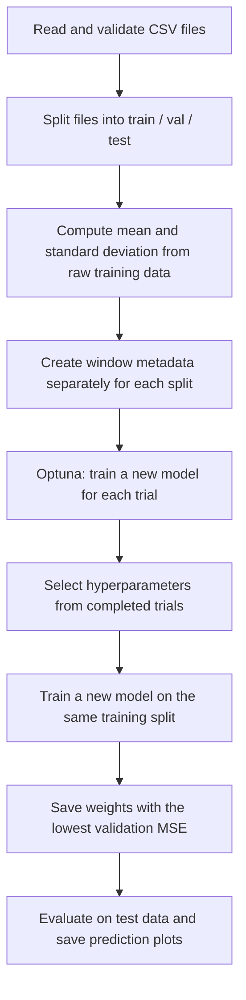
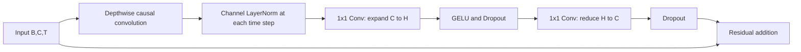

# Detailed Code Review and User Manual for BiLSTM and Causal ModernTCN

Date: 2026-10-19 (Korea Standard Time)

Reviewed files: [py_BiLSTM_std.py](py_BiLSTM_std.py), [py_modernTCN_std.py](py_modernTCN_std.py)

Code baseline: the two final training scripts at commit [`31988e9`](https://github.com/yangjunahn/lrf-sswu/commit/31988e994fe6d35e1308760700ecbd2e4f3ec647)

Theory and previous experiments: [LRF-SSWU-CodeDocumentation_Theory.pdf](LRF-SSWU-CodeDocumentation_Theory.pdf)

Language: English | [Korean version](BiLSTM_ModernTCN_Code_Review_and_User_Manual-kor.md)

This report explains how to understand and run the final training scripts prepared by the student. It connects the theory in the PDF to the classes, functions, and tensor shapes in the code, reviews strengths and defects in the implementation, and provides instructions from environment setup through inference with saved models. Keep the original PDF available and use the section/page mapping in Section 2 when reading the documents together. **The training scripts have not been modified; proposed changes are explicitly identified as recommendations.**

The numerical results quoted from the PDF belong to previous experiments. During preparation of this report, reduced runs and behavioral checks were performed with synthetic data. The full 40-trial search and final training for up to 300 epochs on real ship-motion data were not performed, and their performance is not claimed to have been reproduced.

## Contents

1. [Objective and Overall Execution Flow](#1-objective-and-overall-execution-flow)
2. [Mapping the PDF to the Code](#2-mapping-the-pdf-to-the-code)
3. [Shared Configuration and Data Processing](#3-shared-configuration-and-data-processing)
4. [Detailed Review of the BiLSTM Model](#4-detailed-review-of-the-bilstm-model)
5. [Detailed Review of the Causal ModernTCN Model](#5-detailed-review-of-the-causal-moderntcn-model)
6. [Training, Search, and Final Retraining](#6-training-search-and-final-retraining)
7. [Interpreting Evaluation, Plots, and Saved Outputs](#7-interpreting-evaluation-plots-and-saved-outputs)
8. [Review Findings and Improvement Priorities](#8-review-findings-and-improvement-priorities)
9. [Environment and Data Preparation Manual](#9-environment-and-data-preparation-manual)
10. [Training, Interruption, and Resumption Manual](#10-training-interruption-and-resumption-manual)
11. [Predicting New Data with Saved Models](#11-predicting-new-data-with-saved-models)
12. [A Procedure for Comparing the Two Models Fairly](#12-a-procedure-for-comparing-the-two-models-fairly)
13. [Troubleshooting](#13-troubleshooting)
14. [Validation Scope and References](#14-validation-scope-and-references)

## 1. Objective and Overall Execution Flow

Both scripts take 128 observed samples of six-degree-of-freedom (6-DOF) ship motion and predict the following 128 samples for all six DOFs in one forward pass. Both inputs and targets are motion measurements. Neither `Wave_` waveform files nor wave height, wave period, or ship speed encoded in filenames are supplied as separate model inputs.

| Item | Actual configuration in both scripts |
|---|---|
| Input / output | `(B, 128, 6)` / `(B, 128, 6)` |
| Sampling frequency | Assumed to be 2 Hz, with a 0.5 s interval |
| Input / forecast length | 128 samples each, conventionally described as 64 s |
| Window stride | 16 samples, or 8 s |
| Data split | Shuffle files; allocate approximately 15% to test, 15% to validation, and the remainder to training |
| Training loss | MSE in a space standardized using training statistics |
| Hyperparameter selection | Lowest validation MSE among completed Optuna trials |
| Final model selection | Weights with the lowest validation MSE during fresh final training |
| Evaluation | Standardized MSE/MAE and per-DOF RMSE in the original units |

The interval between the first and last of 128 samples is 63.5 s. A “64 s forecast” here means predicting 128 future samples at lead times from 0.5 s to 64 s after the last input sample. The plotting code labels the first target sample as time zero, so distinguish plot coordinates from lead time measured relative to the last observation.



The scripts describe the second stage as full retraining. **This does not merge the training and validation sets.** A new model is initialized using the selected hyperparameters, trained on the original training set, and stopped using the original validation set. Test data are used neither for hyperparameter search nor for weight updates.

## 2. Mapping the PDF to the Code

The table lists both PDF section numbers and physical PDF pages. Use it to connect the theoretical explanation to the implementation.

| PDF location | Theory or explanation | Corresponding code |
|---|---|---|
| §§1–2, pp.1–2 | Multivariate, multi-step forecasting; 6-DOF; sampling interval | Top-level settings, `dof_cols`, `dof_units` |
| §3, p.2 | Condition split, training-based z-score, windows | `load_id_data`, `make_window_meta`, `TimeWindowDataset`, preprocessing in main |
| §§4.1–4.4, pp.2–4 | Causal convolution, depthwise/pointwise operations, residual connections | ModernTCN classes from `CausalConv1d` through `ModernTCNRegressor` |
| §4.5, p.4; Figure 2, p.5 | Concatenating BiLSTM final states and predicting the full horizon | `SingleShotRNN.forward`, `create_model` |
| §5, p.5 | MSE, AdamW, clipping, scheduler, early stopping | `train_epoch`, `evaluate_epoch`, `build_optimizer_and_scheduler` |
| §6, pp.5–6 | TPE, pruning, search spaces, database resumption | `sample_params`, `make_objective`, `run_study` |
| §§7–8, pp.6–7 | Final retraining, standardized metrics, physical-unit RMSE | Training and test sections in main |
| §9, pp.7–9 | Previous best trials, architecture results, example predictions | Historical reference results; inspect the output folder separately for a current run |

### 2.1 Previous Experimental Results in the PDF

The following values are quoted from Tables 8 and 10 and the accompanying text in PDF §9. They provide reference configurations, not guaranteed performance on new data or in a new environment.

| Item | Causal ModernTCN | BiLSTM |
|---|---|---|
| Previous best trial | 38 | 26 |
| Best validation MSE during search | 0.428539 | 0.440436 |
| Main architecture | channels 128, blocks 4, kernel 55, expansion 2.0, stem kernel 3 | hidden_dim 64, n_layers 4 |
| Dropout | block 0.0, head 0.1 | 0.0 between LSTM layers |
| batch_size | 64 | 128 |
| Trainable parameters | 313,094 | 433,920 |

The parameter counts were checked by constructing these architectures with the current scripts. The MSE values were not measured again. A lower value for ModernTCN in the PDF does not establish superior test performance or statistical significance. In particular, the current `evaluate_epoch()` assigns equal weight to batches; comparisons using different batch sizes must account for the aggregation issue described in Section 8.1.

## 3. Shared Configuration and Data Processing

### 3.1 Code Locations and Function Roles

Links in the table point to the beginning of each function or class in the reviewed files.

| Role | BiLSTM | ModernTCN | What to inspect |
|---|---|---|---|
| Initialize random seeds | [L35](py_BiLSTM_std.py#L35) | [L35](py_modernTCN_std.py#L35) | Python, NumPy, and PyTorch seeds |
| Load CSV files | [L104](py_BiLSTM_std.py#L104) | [L103](py_modernTCN_std.py#L103) | `Wave_` exclusion, column fallback, file filtering |
| Index windows | [L124](py_BiLSTM_std.py#L124) | [L123](py_modernTCN_std.py#L123) | Store positions instead of copying windows |
| Dataset | [L134](py_BiLSTM_std.py#L134) | [L133](py_modernTCN_std.py#L133) | Slice input/target and standardize with the same statistics |
| DataLoader | [L154](py_BiLSTM_std.py#L154) | [L153](py_modernTCN_std.py#L153) | Shuffle and `drop_last` apply only to training |
| Split, calculate statistics, and save | [main L563](py_BiLSTM_std.py#L563) | [main L601](py_modernTCN_std.py#L601) | Allocate test → validation → training and write the scaler |

### 3.2 Meaning of the Top-Level Settings

`ID_DATA_DIR = Path("csv_dataset")` is resolved relative to the **working directory from which the script is run**, rather than the script's own directory. Output paths follow the same rule. Running from the repository root is the simplest approach.

`IN_LEN`, `OUT_LEN`, and `STRIDE` determine slices and window counts. In contrast, `ID_HZ` and `DT_SEC` supply the time axis for plots. Changing `ID_HZ` does not resample the raw data or validate timestamps. Applying the 2 Hz configuration to 10 Hz data changes the physical meaning of the same number of rows.

`TRAIN_RATIO = 0.70` is declared but is not directly used in the split calculation. Training receives the files remaining after test and validation allocation. Editing the training ratio alone does not change the split.

### 3.3 `load_id_data()` — File Selection and Column Handling

Files are processed as follows:

1. Find CSV files directly inside the data directory with `data_dir.glob("*.csv")`, then sort by filename. Subdirectories and `.out` files are not read.
2. Exclude filenames beginning exactly with `Wave_`. The check is case-sensitive.
3. Read six columns using `pd.read_csv(..., usecols=dof_cols)`.
4. If a `ValueError` occurs, read the entire CSV and use its last six columns instead.
5. Convert the values to a `float32` array.
6. Keep the file only if it contains at least `IN_LEN + OUT_LEN` rows and every value is finite.

The default configuration requires at least 256 rows. A single NaN or Inf excludes the entire file. The code does not impute missing values or extract only valid segments. If files exist but none are valid, the function returns an empty list; concatenating training arrays later can then fail.

**Column interpretation:** `usecols` does not reorder the result into the order of the supplied list. Check that the CSV header places the DOF columns in `x1,x2,x3,x4,x5,x6` order. The fallback does not verify that the last six columns actually contain motion values. Training may proceed with six numeric columns even if time, units, or DOF order are incorrect. The manual therefore provides a preflight check based on explicit headers and ordering.

| Column | Interpretation in the scripts | Display/evaluation unit |
|---|---|---|
| x1 | Surge (X), longitudinal translation | m |
| x2 | Sway (Y), lateral translation | m |
| x3 | Heave (Z), vertical translation | m |
| x4 | Roll | deg |
| x5 | Pitch | deg |
| x6 | Yaw | deg |

The code does not convert angle units. Convert radians to degrees before use, or update the data, metadata, and plot units consistently.

### 3.4 File-Level Splitting and Leakage Prevention

For $C$ valid files, the scripts calculate:

$$
n_{test}=\max(1,\operatorname{round}(0.15C)),\qquad
n_{val}=\max(1,\operatorname{round}(0.15C)).
$$

File indices are shuffled with seed 42 and allocated to test, validation, and training in that order. Python's `round` uses ties-to-even for exact halfway values, so its behavior can differ from always rounding 0.5 upward. The split ratios apply to file counts, not row or window counts.

Because windows are generated after splitting, overlapping segments from the same file cannot enter both training and test sets. This and training-only normalization are important strengths of the implementation. However, differently named duplicates of a physical condition or fragments of one simulation can still produce condition leakage. The scripts do not parse heading, Tm, Hs, or V from filenames; verify that file-level separation also represents physically independent conditions.

### 3.5 Normalization Using Training Statistics

All rows from training files are concatenated to compute a per-DOF mean $\mu_d$ and standard deviation $\sigma_d$. NumPy's default standard deviation, `ddof=0`, is used.

$$
z_{t,d}=\frac{x_{t,d}-\mu_d}{\sigma_d},\qquad
x_{t,d}=z_{t,d}\sigma_d+\mu_d.
$$

Only entries satisfying `data_std == 0` are replaced by 1. There is no lower bound for very small positive standard deviations. Longer files contribute more heavily to the statistics. The original arrays and `train_concat` remain in memory, so reducing duplicated windows does not make this a fully streaming data pipeline.

`scaler.json` contains `dof_cols`, `mean`, `std`, `train_files`, `val_files`, and `test_files`. Reuse the training statistics unchanged during inference. Recomputing them from a new input would place that input in a different coordinate system from the one learned by the model.

### 3.6 `make_window_meta()` and `TimeWindowDataset`

For a file with $N$ rows and stride $S$, the number of windows is:

$$
W(N)=\max\left(0,\left\lfloor\frac{N-L_{in}-L_{out}}{S}\right\rfloor+1\right).
$$

With the defaults, 256 rows yield 1 window, 400 rows yield 10, and 800 rows yield 35. `meta` stores only `(file_idx, start_idx)`. On demand, `__getitem__()` extracts and standardizes the following segments:

```python
x = raw_arr[start_idx:start_idx + 128]          # History (128, 6)
y = raw_arr[start_idx + 128:start_idx + 256]    # Future (128, 6)
```

Windows never cross file boundaries, and input and target segments do not overlap within a window. Adjacent windows overlap substantially with each other. This supplies more training examples but does not make evaluation samples independent. Longer files also produce more windows, so the loss and RMSE do not assign equal weight to each condition.

### 3.7 `make_loaders()`

| Setting | Training | Validation / test |
|---|---|---|
| `shuffle` | `True` | `False` |
| `drop_last` | `True` | Default `False` |
| `pin_memory` | `True` | `True` |
| Default `num_workers` | 4 | 4 |

The last incomplete training batch is discarded. If there are fewer training windows than the batch size, the DataLoader has length zero and the division in `train_epoch()` fails. The largest default batch candidate is 128, so check for at least 128 training windows before running the default search. Use `num_workers=0` when memory or process creation causes problems. `pin_memory=True` does not enable multi-GPU training.

## 4. Detailed Review of the BiLSTM Model

Code: [`SingleShotRNN`, L166–216](py_BiLSTM_std.py#L166), [`create_model`, L219–231](py_BiLSTM_std.py#L219). Theory: PDF §4.5.

### 4.1 LSTM States and Bidirectional Encoding

An LSTM updates sequential information using input, forget, and output gates together with a cell state. Conceptually, the cell and hidden states are:

$$
c_t=f_t\odot c_{t-1}+i_t\odot g_t,\qquad
h_t=o_t\odot\tanh(c_t).
$$

`nn.LSTM` performs the actual gate calculations. The forward direction processes the observed window chronologically; the backward direction processes the same window in reverse. Both read only the 128 historical samples already available at the forecast origin. No future ground truth is supplied to the encoder. However, the model does not impose past-only dependencies at every position inside the observed window.

`SingleShotRNN` supports GRU and unidirectional configurations, but the actual `create_model()` fixes **LSTM, bidirectional=True, six inputs, and six outputs**. Running this script does not search over GRU models.

### 4.2 Tensor Flow and Final-State Selection

| Stage | Implementation | Shape |
|---|---|---|
| Input | `batch_first=True` | `(B, 128, 6)` |
| Final LSTM hidden states | `h_n` | `(2L, B, H)` |
| Final forward state of the last layer | `h_n[-2]` | `(B, H)` |
| Final backward state of the last layer | `h_n[-1]` | `(B, H)` |
| Concatenate directions | `torch.cat(..., dim=-1)` | `(B, 2H)` |
| FC output | `Linear(2H, 128*6)` | `(B, 768)` |
| Final prediction | `reshape` | `(B, 128, 6)` |

$L$ is the layer count and $H$ is `hidden_dim`. For a bidirectional LSTM, `output[:, -1, :]` does not have the same meaning as the final states of both directions in `h_n`. The implementation explicitly selects the two final states, matching its intended design. The cell state `c_n` is not passed to the head. See the [official LSTM documentation](https://docs.pytorch.org/docs/stable/generated/torch.nn.LSTM.html) for state and Dropout definitions.

### 4.3 Single-Shot Head and Dropout

A single linear layer generates all 128 future positions. There is no separate recurrent decoder, teacher forcing, or autoregressive loop that feeds a prediction into the next step. This avoids that particular route of recursive error propagation, while compressing the full history into a fixed-size `(B, 2H)` representation.

The head has neither an activation nor Dropout. LSTM Dropout applies only between stacked layers and is forced to zero when `n_layers=1`. `sample_params()` likewise skips sampling Dropout for a single layer. Consequently, `study.best_params` may lack a `dropout` key, but `create_model()` and the `model_config.json` writer handle this with a 0.0 default.

`in_len` is stored on the object but is not used to validate the input length. The FC layer fixes the output length. The ability to pass a different input length does not mean performance at that length has been validated; use the same 128-sample input as in training.

### 4.4 Parameter Count and Model Capacity

For a bidirectional LSTM with input dimension $D=6$, biases, and no projection, the parameter count is:

$$
P=8H(D+H+2)+(L-1)8H(3H+2)+(2H+1)(6L_{out}).
$$

The first two terms belong to the LSTM; the last belongs to the FC layer. The PDF's best configuration, `H=64, L=4, L_out=128`, has 433,920 parameters. Larger hidden dimensions and more layers increase parameter count and training cost quickly. The PDF also shows that larger models did not consistently reduce validation error, so assess capacity together with validation performance.

## 5. Detailed Review of the Causal ModernTCN Model

Code: [`L165–273`](py_modernTCN_std.py#L165). Theory: PDF §§4.1–4.4. “ModernTCN” in this report denotes this repository's `Causal ModernTCN` implementation. It does not imply that dilated convolutions or components from other TCN implementations are present.

### 5.1 Overall Tensor Flow

| Stage | Code component | Output shape |
|---|---|---|
| Input | Standardized motion history | `(B, 128, 6)` |
| Channels-first conversion | `PermuteToChannelsFirst` | `(B, 6, 128)` |
| Input projection | `CausalConv1d(6, C, stem_kernel_size)` | `(B, C, 128)` |
| Feature extraction | `ModernTCNBlock` × `num_blocks` | `(B, C, 128)` |
| Backbone return | `PermuteToTimeFirst` | `(B, 128, C)` |
| Prepare temporal projection | `transpose(1, 2)` | `(B, C, 128)` |
| Temporal projection | `Linear(IN_LEN, OUT_LEN)` → GELU → Dropout | `(B, C, 128)` |
| Output projection | Transpose → `Linear(C, 6)` | `(B, 128, 6)` |

The class constructor defaults to `out_len=64`, but the training script's `create_model()` explicitly supplies the global `OUT_LEN=128`. The actual forecast length in this experiment is 128. Calling the constructor with its defaults during inference can overlook this difference.

### 5.2 `CausalConv1d` — Left Padding

For kernel size $k$, the layer prepends $k-1$ zeros and applies `Conv1d` with `padding=0`. Stride and dilation both retain their default value of 1. Output length equals input length, and the feature at time $t$ depends only on the current and earlier input samples.

At the beginning of the window, zeros replace unavailable earlier observations. Larger kernels and deeper stacks can increase this padding effect. With $N_b$ blocks, block kernel $k$, and stem kernel $k_s$, the theoretical backbone receptive field is:

$$
R=k_s+N_b(k-1).
$$

For the PDF's best configuration, $R=3+4(55-1)=219$ samples, exceeding the 128-sample observed window. Actual observations remain restricted to the window, with padding elsewhere. Since the final temporal head combines all input positions, this receptive field describes position-specific backbone features.

### 5.3 `ModernTCNBlock` — Temporal Processing and Channel Mixing



`dwconv` uses `groups=channels` to process temporal patterns independently for each hidden channel. This operation does not mix channels. The stem, however, already mixes the six DOFs through a regular convolution. A hidden channel therefore does not correspond directly to one physical DOF.

`ChannelLayerNorm` converts `(B,C,T)` to `(B,T,C)`, applies `LayerNorm(C)` over channels at each time step, and restores the layout. Its statistics do not combine the whole time axis or batch, so normalization does not introduce later-time information into a current feature. It is a learned internal normalization, distinct from the Dataset's z-score scaling.

`pwffn` uses two kernel-size-1 convolutions to mix channels at the same time step. Its intermediate width is `int(channels * expansion)`. It applies GELU for nonlinearity, applies Dropout twice, and adds the original block input. The residual addition is possible because all operations preserve `(B,C,T)` shape.

### 5.4 Temporal Head and the Scope of Causality

`Linear(IN_LEN, OUT_LEN)` acts on the final, temporal axis. The same temporal transformation matrix is applied to every hidden channel, and `output_projection` converts each future position's channel representation into six DOFs. The head receives features at all observed positions, rather than only one final state as in BiLSTM.

The backbone is causal even within the observed window. The head uses **the entire input window available at the forecast origin**. This does not leak future targets, but it would be inaccurate to claim that every position, including the head, depends only on its own preceding positions. The full model also predicts 128 future positions at once without autoregressive rollout.

### 5.5 Parameter Count

With hidden width $C$, expanded width $H$, and $N_b$ blocks, component counts are as follows. Biases and LayerNorm affine parameters are included.

| Component | Parameters |
|---|---|
| Stem | $6Ck_s+C$ |
| One block | $(Ck+C)+2C+(CH+H)+(HC+C)$ |
| Temporal projection | $L_{in}L_{out}+L_{out}$ |
| Output projection | $6C+6$ |

The PDF's best configuration has 313,094 parameters, confirmed with the code. Convolutions allow parallel computation across temporal positions, but no GPU speed comparison was performed here; the report does not claim a measured speedup over BiLSTM.

## 6. Training, Search, and Final Retraining

### 6.1 Function Map

| Role | BiLSTM | ModernTCN |
|---|---|---|
| Weight updates | [`train_epoch`, L240](py_BiLSTM_std.py#L240) | [`train_epoch`, L282](py_modernTCN_std.py#L282) |
| Validation/test metrics | [`evaluate_epoch`, L256](py_BiLSTM_std.py#L256) | [`evaluate_epoch`, L298](py_modernTCN_std.py#L298) |
| AdamW and scheduler | [L267](py_BiLSTM_std.py#L267) | [L309](py_modernTCN_std.py#L309) |
| Search space | [`sample_params`, L278](py_BiLSTM_std.py#L278) | [`sample_params`, L320](py_modernTCN_std.py#L320) |
| Per-trial training | [`make_objective`, L298](py_BiLSTM_std.py#L298) | [`make_objective`, L338](py_modernTCN_std.py#L338) |
| Attempted resource cleanup | [`_cleanup`, L378](py_BiLSTM_std.py#L378) | [`_cleanup`, L418](py_modernTCN_std.py#L418) |
| Database summary export | [`save_study_results`, L385](py_BiLSTM_std.py#L385) | [`save_study_results`, L425](py_modernTCN_std.py#L425) |
| Trial-end callback | [`_save_callback`, L403](py_BiLSTM_std.py#L403) | [`_save_callback`, L443](py_modernTCN_std.py#L443) |
| Study setup and resumption | [`run_study`, L408](py_BiLSTM_std.py#L408) | [`run_study`, L448](py_modernTCN_std.py#L448) |
| Load a study without searching | [`load_study_only`, L466](py_BiLSTM_std.py#L466) | [`load_study_only`, L504](py_modernTCN_std.py#L504) |
| Final training entry | [L637](py_BiLSTM_std.py#L637) | [L661](py_modernTCN_std.py#L661) |

### 6.2 Loss and the Processing of One Epoch

Each batch uses MSE in standardized space:

$$
\mathcal L=\frac{1}{B L_{out} 6}
\sum_{b,h,d}(\hat z_{b,h,d}-z_{b,h,d})^2.
$$

`train_epoch()` performs `model.train()` → device transfer → gradient reset → prediction → MSE → backpropagation → gradient norm clipping → AdamW update. Clipping with `max_norm=1.0` applies to the gradient norm across model parameters; it does not clamp each gradient element individually to [-1,1].

Equal weighting of DOFs in standardized space corresponds to weighting squared errors in original units by $1/\sigma_d^2$. This reduces the problem of directly mixing numerical scales in m and deg, but it does not aim to reduce every physical DOF error by the same numerical amount.

`evaluate_epoch()` computes MSE/MAE with `model.eval()` and `torch.no_grad()`, disabling Dropout and weight updates. Training loss is measured while weights change and Dropout is active. Validation loss being lower than training loss is therefore not, on its own, proof of leakage. See Section 8.1 for the batch aggregation issue in returned epoch metrics.

### 6.3 AdamW, Learning-Rate Reduction, and Early Stopping

Both scripts use `AdamW(lr=learning_rate, weight_decay=weight_decay)`. `ReduceLROnPlateau(mode="min", factor=0.5, patience=3)` receives validation loss and halves the learning rate when its criteria are met. Its internal improvement criterion is not identical to the manual early-stopping comparison `val_loss < best_val`.

Early stopping occurs after 10 consecutive epochs without improvement. Any strict decrease counts; there is no separate `min_delta`. A trial runs for at most 40 epochs and final training for at most 300. `history["lr"]` records the learning rate after the scheduler processes that epoch's validation result; it is not necessarily the rate used for all batches of that epoch.

### 6.4 Search Spaces

| BiLSTM parameter | Candidates / range |
|---|---|
| `hidden_dim` | 64, 128, 256, 512 |
| `n_layers` | Integers 1–8 |
| `dropout` | 0.00–0.30 in 0.05 steps for multiple layers; 0 for one layer |
| `learning_rate` | $10^{-4}$–$5\times10^{-3}$, log scale |
| `weight_decay` | $10^{-5}$–$10^{-2}$, log scale |
| `batch_size` | 32, 64, 128 |

| ModernTCN parameter | Candidates / range |
|---|---|
| `channels` | 64, 96, 128, 192, 256 |
| `num_blocks` | Integers 2–8 |
| `kernel_size` | 7, 15, 23, 31, 39, 47, 55, 63 |
| `expansion` | 1.0, 2.0, 3.0, 4.0 |
| `dropout`, `head_dropout` | Each 0.00–0.30 in 0.05 steps |
| `stem_kernel_size` | 3, 5, 7, 11, 15, 21 |
| `learning_rate`, `weight_decay`, `batch_size` | Same as BiLSTM |

`count_parameters()` sums parameters with `requires_grad=True` and records the result in `trial.user_attrs["n_params"]`. This helps analyze performance versus capacity. Model size is not penalized in the objective itself.

### 6.5 Trial and Study Behavior

Every trial resets the seed to 42 and constructs a new model, optimizer, and loaders. `trial.report(val_loss, step=epoch)` records intermediate results while the objective tracks its minimum validation loss. The returned objective is **the lowest validation MSE during the trial, not the last epoch's loss**. `epochs_done`, `best_val_so_far`, and `n_params` are recorded, but trial model weights are not saved.

`TPESampler(seed=42, n_startup_trials=8)` proposes configurations using previous evaluations after startup. `MedianPruner(n_startup_trials=8, n_warmup_steps=8)` uses intermediate results from other completed trials to stop unpromising trials. Steps are reported starting at 1; check the configured values and library boundary conditions rather than assuming that exactly the first eight epochs are exempt. The verified environment follows the [Optuna 4.5.0 MedianPruner definition](https://optuna.readthedocs.io/en/v4.5.0/reference/generated/optuna.pruners.MedianPruner.html).

Pruning is checked before within-trial early stopping. Non-finite validation loss causes pruning, but ordinary runtime exceptions, such as CUDA out-of-memory, are not caught to continue to the next trial.

A study is identified by `EXP_NAME` and its SQLite database path. With `load_if_exists=True`, existing trials are reused. The number of additional trials is:

```python
n_done = sum(t.state != optuna.trial.TrialState.RUNNING for t in study.trials)
n_remaining = max(0, OPTUNA_CONFIG["n_trials"] - n_done)
```

Thus, a budget of 40 does not guarantee 40 COMPLETE trials. PRUNED and FAIL states count toward the budget; stale RUNNING trials left by abnormal termination do not. Training of a RUNNING trial is not resumed from its weights or epoch. The sampler is recreated with seed 42 on restart, so database resumption does not restore the exact proposal sequence of an uninterrupted TPE search.

### 6.6 Final Retraining and Checkpoints

At least one completed trial is required to obtain `study.best_params`. The seed is reset and a fresh model is trained with the selected settings for up to 300 epochs. Whenever `val_loss < best_val_loss`, its `model.state_dict()` overwrites the saved weights. This does not continue training the best trial's weights.

The original training split is used while validation remains separate. After training, the best saved weights are reloaded for test evaluation. Search `best_value` and `final_best_val_mse` belong to different stages and training budgets and should be distinguished.

The saved checkpoint contains weights only. It does not include optimizer, scheduler, current epoch, or random states for training resumption. After final training is interrupted, running with `skip_search=True` **starts final training again from scratch**.

## 7. Interpreting Evaluation, Plots, and Saved Outputs

### 7.1 Standardized MSE and MAE

`test_mse_zscore` and `test_mae_zscore` are dimensionless metrics combining all forecast positions and DOFs. Apart from the aggregation issue in Section 8.1, batch MSE follows Section 6.2 and batch MAE is the mean absolute error. The square root of `test_mse_zscore` is different from each DOF's RMSE in physical units.

### 7.2 Per-DOF RMSE in Physical Units

Prediction and target use the same mean, which cancels when transforming errors back:

$$
e_{b,h,d}^{phys}=(\hat z_{b,h,d}-z_{b,h,d})\sigma_d,
\qquad
\operatorname{RMSE}_d=\sqrt{\frac{\sum_{b,h}(e_{b,h,d}^{phys})^2}{N_{test}L_{out}}}.
$$

$N_{test}$ is the number of test windows. The implementation accumulates the **sum** of squared errors across batches and divides by total windows × forecast length, so this calculation avoids the equal-batch-weight issue in `evaluate_epoch()`. Overlapping windows still evaluate the same raw time point at multiple forecast positions. The score describes a window-based forecasting experiment, not an evaluation counting every unique raw timestamp once.

Surge, sway, and heave RMSEs are in m; roll, pitch, and yaw RMSEs are in deg. Do not interpret the sum of these six values as a single physical error. Lead-time-specific RMSE, equal-condition-weight RMSE, prediction intervals, and uncertainty estimation are not implemented.

### 7.3 Reading the Plots

| Function / plot | Behavior and interpretation |
|---|---|
| `plot_study()` | Produces `optuna_history.png` and `optuna_param_importance.png`; plot errors are reported and skipped |
| `plot_training_curves()` | Shows training/validation MSE and the best epoch; x coordinates start at 0, while the best-epoch label starts at 1 |
| `plot_test_predictions()` | Uses `linspace` over test Dataset indices to select at most four windows; these are neither random nor selected as best cases |
| `test_pred_<file stem>_start<row>.png` | 3×2 panels with gray history, green truth, and red prediction in original units; 500 dpi |

Four example plots do not necessarily represent all conditions or the error distribution. History coordinates are `-64, -63.5, …, -0.5` s and future coordinates are `0, 0.5, …, 63.5` s. Add 0.5 s to the future axis when expressing lead time relative to the last observation.

Parameter-importance plots may be unavailable with too few completed trials, missing dependencies, or a search whose parameter values do not vary. In the verified Optuna 4.5.0 environment, the default fANOVA importance evaluator uses scikit-learn; see the [version-specific documentation](https://optuna.readthedocs.io/en/v4.5.0/reference/generated/optuna.importance.FanovaImportanceEvaluator.html). Conditional parameters absent from some trials, such as BiLSTM `dropout`, may be omitted from the default importance analysis.

### 7.4 Output Folders and Files

Default output locations are shown below. `experiments0917` and `experiments0904` are hardcoded names, not the date of the current run.

```text
experiments0917/BiLSTM_SingleShot_optuna_in128_out128_stride16/
experiments0904/CausalModernTCN_optuna_in128_out128_stride16/
```

| File | Contents | Creation time / caveat |
|---|---|---|
| `models/best_model.pt` | State dict with the best validation loss during final training | Not the weights of a search trial |
| `scaler.json` | Six means/stds and train/validation/test file lists | Written or overwritten before loading the database |
| `model_config.json` | Input/output dimensions, lengths, and LSTM structure | **BiLSTM only** |
| `optuna_study.db` | Trial settings, objective/intermediate values, attributes | Used for study resumption; no model weights |
| `optuna_trials.csv` | Trial table | Updated by the trial-end callback and other summary saves |
| `best_params.json` | Best-trial settings and summary; test metrics merged after completion | Saving search summaries on rerun can remove previous test metrics |
| `history.json` | Lists of `train_loss`, `val_loss`, `val_mae`, and `lr` | Written after the final training loop finishes |
| `plots/optuna_history.png` | Search history | If visualization succeeds |
| `plots/optuna_param_importance.png` | Parameter importance | If visualization succeeds |
| `plots/training_curves.png` | Final training loss curves | After final training |
| `plots/test_pred_*.png` | At most four prediction examples | After test evaluation |

Key meanings in `best_params.json`:

```text
n_trials_total / n_trials_complete  Total recorded trials / completed trials
best_trial / best_value            Selected search trial / its minimum validation MSE
best_params                       Architecture, optimizer, and batch settings
final_best_val_mse                 Minimum validation MSE during final training
test_mse_zscore / test_mae_zscore   Standardized test metrics of the final model
test_rmse_per_dof                  Six DOF RMSEs in original units
```

## 8. Review Findings and Improvement Priorities

The findings below concern the current implementation. “High” means a problem can change successful execution or experimental interpretation; it does not mean every input fails immediately. These are recommendations, not changes applied to the training scripts.

| ID | Priority | Finding | Impact and recommended action |
|---|---|---|---|
| R1 | High | Validation/test MSE and MAE average batches equally | Can affect trial ranking; aggregate using total element count |
| R2 | High | ModernTCN checks `interrupted` across all historical trials | Can skip final training even after resumption finishes; inspect only trials from the current invocation |
| R3 | High | Studies lack data/preprocessing identity | Mixes historical performance with new data; separate studies/databases and preserve manifests |
| R4 | High | CSV order and fallback semantics are not guaranteed | Can misidentify DOFs or inputs; reorder columns explicitly and validate units |
| R5 | High | No checks for empty training sets/loaders or batch feasibility | Concatenation or division-by-zero failures; check files/windows before training |
| R6 | Medium | ModernTCN `skip_search` does not regenerate summary JSON | A database-only recovery can fail after training when reading JSON; save a summary before retraining |
| R7 | Medium | `_cleanup()` does not release caller references | Actual GPU object lifetimes differ from the apparent cleanup intent; release references at the correct scope |
| R8 | Medium | Intermediate training state is not saved; exception handling is limited | Expensive restarts and search termination on OOM; add checkpoints and an exception policy |
| R9 | Medium | Output reuse and summary overwrites | Scaler/weight/JSON mismatch or lost metrics; preserve a folder per run |
| R10 | Medium | A seed alone does not ensure full reproducibility | Record versions, device, and resumption details; evaluate multiple seeds |
| R11 | Enhancement | No per-file/lead-time evaluation or time/unit validation | State the limits of data/generalization claims and design additional metrics |

### 8.1 R1 — Averaging Batch Means

Locations: [BiLSTM `evaluate_epoch`](py_BiLSTM_std.py#L256), [ModernTCN `evaluate_epoch`](py_modernTCN_std.py#L298).

The implementation adds the mean MSE/MAE of each batch and divides by the number of batches. Samples in a smaller last batch receive greater weight. Since batch size is a search parameter, this affects not only reported metrics but potentially best-trial selection, scheduling, and early stopping.

Reproduction example: there are 33 windows; every error is zero in the first 32 windows and 10 in the last window. Batch size is 32.

| Metric | Current function | Correct aggregation over all elements |
|---|---|---|
| MSE | `(0 + 100) / 2 = 50` | `100 / 33 ≈ 3.030303` |
| MAE | `(0 + 10) / 2 = 5` | `10 / 33 ≈ 0.303030` |

This difference was reproduced with the actual `evaluate_epoch()` in both scripts. It disappears when every batch is the same size. Training uses equal batch sizes because `drop_last=True`, but its score still excludes discarded windows.

**Proposed correction:** compute the current MSE-based evaluation from element sums as follows. This is a proposal in the report and has not been applied to the scripts.

```python
@torch.no_grad()
def evaluate_epoch(model, loader, criterion, show_bar=True):
    model.eval()
    squared_sum, absolute_sum, count = 0.0, 0.0, 0
    for src, trg in tqdm(loader, desc="Eval", leave=False, disable=not show_bar):
        src, trg = src.to(device), trg.to(device)
        error = model(src) - trg
        squared_sum += error.square().sum().item()
        absolute_sum += error.abs().sum().item()
        count += trg.numel()
    if count == 0:
        raise RuntimeError("There are no elements to evaluate.")
    return squared_sum / count, absolute_sum / count
```

After changing aggregation, start a new study rather than mixing the new objective with old database values. Existing best weights can be reevaluated, but the same trial is not guaranteed to remain optimal under a corrected search metric.

### 8.2 R2 — Historical Interruption Flags in ModernTCN

Location: [ModernTCN L484](py_modernTCN_std.py#L484); comparison: [BiLSTM L432](py_BiLSTM_std.py#L432).

ModernTCN marks the current invocation as `interrupted=True` whenever any trial in the database has a truthy `user_attrs["interrupted"]`. Once an earlier Ctrl+C is recorded, later invocations can continue skipping final training under the default `train_after_interrupt=False`, even after search completion. This also happens when the trial budget is already exhausted and no new trial runs.

BiLSTM stores `previous_numbers` before optimization and checks **only trials created by the current invocation**, avoiding this issue. A fake study containing one historically interrupted trial returned False for BiLSTM and True for ModernTCN during verification. No actual keyboard interrupt signal was sent in that check.

**Workaround with unchanged source:** if the database contains a completed trial, set `skip_search=True`. The `load_study_only(), False` branch then enters final training. To finish additional search trials and proceed to training, inspect the historical/current status and consider `train_after_interrupt=True`. This latter option also allows training after an interruption in the current invocation.

**Proposed correction:** follow BiLSTM's approach by comparing trial numbers before and after `study.optimize()` and inspecting interruption flags only for new trials.

### 8.3 R3/R9 — Experiment Identity and Artifact Preservation

The default `EXP_NAME` contains only model name, input/output lengths, and stride. Data contents, seed, split ratios, normalization, or metric implementation can change without changing the name. Reusing that output folder mixes past trials with a new experiment.

Main also overwrites `scaler.json` from the current data **before checking compatibility with an existing database or weights**. Retaining old best weights with a newly calculated scaler can corrupt inference. `save_study_results()` writes a fresh JSON payload, so a rerun can also erase previously stored test metrics.

Use a new `EXP_NAME` and output path whenever data, splits, metrics, or code change, and preserve completed folders in full. A future implementation should save data-file hashes, code commit, environment versions, settings, and a split hash in a manifest and validate it against the existing study. Storing final test metrics separately in `metrics.json` can prevent search-summary updates from overwriting them.

### 8.4 R4/R5 — Input Validation and Small Datasets

Silently replacing named columns with the final six columns offers convenience but invites misinterpretation. Prefer explicit ordering with `df.loc[:, dof_cols]` and clear errors for missing columns. If fallback is necessary, make it an explicit option and save the actual mapping.

At least three valid files are needed to put one file in each split. This alone does not make training feasible: if training windows total fewer than a batch candidate, the loader contains no batches. Validate `STRIDE > 0`, six valid columns, nonempty splits, and sufficient training windows. Diagnostics for very small standard deviations and all-invalid file lists can also be improved.

### 8.5 R6 — Skipping Search in a Database-Only ModernTCN Recovery

`load_study_only()` returns a study without writing `best_params.json`. BiLSTM main calls `save_study_results(study)` before final training; ModernTCN main does not. A normal search leaves the JSON in place, but restoring only SQLite and running with `skip_search=True` can fail after expensive retraining when the script opens the missing JSON to merge test metrics.

Before running, check that both the database and `best_params.json` exist. A future correction should create the summary before final training and construct final metrics in memory before saving them.

### 8.6 R7/R8 — Cleanup, Interruptions, and Exceptions

In `_cleanup(*objs)`, `del o` deletes only the local loop variable. The `objs` tuple and caller variables still reference the model and optimizer. `torch.cuda.empty_cache()` does not free live tensors either. `gc_after_trial=True` and the end of function scope have separate effects, but `_cleanup()` itself should not be described as immediately deleting a GPU model. Release references in the caller's scope and use `try/finally` to guarantee cleanup.

Ctrl+C is handled inside the objective's training `try` block. If an epoch has completed and `finish_partial_trial=True`, the objective returns its best value so far, records COMPLETE, and stops the study. Such a trial may have trained less than others; read `interrupted` and `epochs_done` together. Signals during model construction, final training, or forced termination are not all handled identically. Final `history.json` is written after the loop, so an interruption can leave the latest history unsaved.

Ordinary exceptions, including CUDA OOM, can terminate the entire search under the current configuration. Bound the search to available memory and define whether expected exceptions should yield failed or pruned trials. A resumable checkpoint also needs optimizer, scheduler, epoch, best value, and random states.

### 8.7 R10/R11 — Reproducibility and Experimental Interpretation

Seed 42 is applied to Python, NumPy, and PyTorch, but this does not include deterministic algorithm settings, environment locking, data hashes, or full restoration of sampler state. The same seed also does not give different architectures identical initial weights or Dropout random sequences. Check final conclusions across multiple seeds.

The scripts do not validate timestamp spacing, missing times, sensor units, groups sharing a physical condition, or whether evaluation is extrapolative. Do not broaden a file-split test result into a claim of validated generalization in actual ship operations. Lead-time/condition metrics, baseline models, and repeated experiments can be added in subsequent analysis.

## 9. Environment and Data Preparation Manual

### 9.1 Requirements and Verified Environment

You need the two training scripts, a Python environment, and motion CSV files arranged at an actual sampling rate of 2 Hz. The PDF is a reference for theory, architecture, and previous results; it is not an input file read by the programs. These instructions assume Linux/bash.

The reduced runs were checked in the following environment. This is not a statement of the student's original experimental environment, nor a verification of every other version combination.

| Component | Verified environment |
|---|---|
| Python | 3.10.12 |
| PyTorch | 2.5.1+cu124, executed on CPU |
| NumPy / pandas | 2.2.6 / 2.2.3 |
| Matplotlib / tqdm | 3.10.0 / 4.67.1 |
| Optuna / scikit-learn | 4.5.0 / 1.7.0 |

The scripts select `cuda:0` when an NVIDIA GPU is available and CPU otherwise. Automatic MPS selection, multi-GPU/distributed training, and mixed precision are not implemented.

### 9.2 Repository and Virtual Environment Setup

If you already have the repository, start with environment setup in that directory. The command below assumes a Python 3.10 executable named `python3.10` is installed.

```bash
git clone https://github.com/yangjunahn/lrf-sswu.git
cd lrf-sswu
python3.10 -m venv .venv
source .venv/bin/activate
python -m pip install --upgrade pip
```

For Linux without GPU use, the following commands illustrate installation matching the verified package versions. They install a CPU wheel into a new environment; a fresh installation was not itself tested for this report.

```bash
python -m pip install torch==2.5.1 --index-url https://download.pytorch.org/whl/cpu
python -m pip install numpy==2.2.6 pandas==2.2.3 matplotlib==3.10.0 tqdm==4.67.1 optuna==4.5.0 scikit-learn==1.7.0
```

For CUDA, select a PyTorch build suitable for your GPU and driver using the [official installation guide](https://pytorch.org/get-started/locally/). Do not replace a working GPU installation by running the CPU command above. These scripts do not require torchvision or torchaudio.

Check the installation:

```bash
python - <<'PY'
import sys
import numpy, pandas, matplotlib, tqdm, optuna, sklearn, torch
print("Python:", sys.version.split()[0])
print("PyTorch:", torch.__version__)
print("CUDA build:", torch.version.cuda)
print("CUDA available:", torch.cuda.is_available())
print("Optuna:", optuna.__version__)
if torch.cuda.is_available():
    print("GPU:", torch.cuda.get_device_name(0))
PY
```

Even with a CUDA build, `CUDA available=False` means the process uses CPU. This was the case in the report's validation environment.

### 9.3 CSV Layout, Timing, and Units

The default layout is shown below. Filenames and sample rows illustrate the format and are not experimental data.

```text
lrf-sswu/
├── py_BiLSTM_std.py
├── py_modernTCN_std.py
├── csv_dataset/
│   ├── condition_001.csv
│   ├── condition_002.csv
│   ├── ...
│   └── Wave_condition_001.csv   # Waveform file excluded by the scripts
└── LRF-SSWU-CodeDocumentation_Theory.pdf
```

```csv
time,x1,x2,x3,x4,x5,x6
0.0,0.01,0.02,0.03,0.10,0.20,0.30
0.5,0.02,0.03,0.04,0.11,0.21,0.31
```

The time column is not passed to the model. Check chronological order, 0.5 s spacing, continuity, and consistent origins, units, and coordinate systems in the raw data. Each file needs at least 256 rows and no NaN/Inf. Keep `x1` through `x6` in order, with column names in the first row.

At the time of report preparation, the workspace did not contain `csv_dataset`. Do not assume that `dataset`, `dataset_grid`, or other repository folders automatically have the required format and sampling rate. If your validated data are elsewhere, change `ID_DATA_DIR` in **both scripts** or prepare the default directory. Perform any required preprocessing/resampling separately and record it.

### 9.4 Preflight Check

Run the following from the repository root. It checks schema, valid lengths, splits, and window counts without importing the training modules. It deliberately validates columns more strictly than the original fallback. Match `data_dir`, lengths, and ratios to your actual training settings.

```bash
python - <<'PY'
from pathlib import Path
import numpy as np
import pandas as pd

data_dir = Path("csv_dataset")
cols = ["x1", "x2", "x3", "x4", "x5", "x6"]
in_len, out_len, stride = 128, 128, 16
val_ratio, test_ratio = 0.15, 0.15
assert stride > 0
files = sorted(p for p in data_dir.glob("*.csv") if not p.name.startswith("Wave_"))
if not files:
    raise SystemExit(f"No CSV files found: {data_dir.resolve()}")
valid, schema_errors = [], []
for path in files:
    try:
        df = pd.read_csv(path)
        if [c for c in df.columns if c in cols] != cols:
            raise ValueError("Missing or incorrectly ordered x1–x6 columns")
        arr = df.loc[:, cols].to_numpy(dtype=np.float32)
    except (ValueError, TypeError, pd.errors.ParserError) as exc:
        schema_errors.append(f"{path.name}: {exc}")
        continue
    if len(arr) < in_len + out_len or not np.isfinite(arr).all():
        print("File to exclude:", path.name, "rows:", len(arr))
        continue
    windows = (len(arr) - in_len - out_len) // stride + 1
    valid.append((path.name, windows))
if schema_errors:
    raise SystemExit("Fix column/numeric formats:\n" + "\n".join(schema_errors))
if len(valid) < 3:
    raise SystemExit("At least three valid files are required.")
indices = np.arange(len(valid))
np.random.RandomState(42).shuffle(indices)
n_test = max(1, int(round(len(valid) * test_ratio)))
n_val = max(1, int(round(len(valid) * val_ratio)))
splits = {
    "train": indices[n_test + n_val:],
    "val": indices[n_test:n_test + n_val],
    "test": indices[:n_test],
}
counts = {}
for name, ids in splits.items():
    counts[name] = sum(valid[i][1] for i in ids)
    print(name, "files:", len(ids), "windows:", counts[name])
if any(counts[k] == 0 for k in counts):
    raise SystemExit("One or more splits are empty.")
if counts["train"] < 128:
    raise SystemExit("Training windows are fewer than the default batch_size=128. Adjust data/batch candidates.")
print("Schema/window checks passed. Verify sampling rate, units, and condition independence separately.")
PY
```

## 10. Training, Interruption, and Resumption Manual

### 10.1 Configuration Before Running

The scripts have no CLI argument parser, so options such as `--epochs`, `--batch-size`, and `--skip-search` are not provided. Edit the top-level configuration and `sample_params()`. For comparisons, match data, input/output lengths, stride, split ratios, and seed.

| Purpose | Setting to edit | Caveat |
|---|---|---|
| Data location | `ID_DATA_DIR` | Verify actual 2 Hz motion data |
| History/forecast length | `IN_LEN`, `OUT_LEN` | Use a new experiment name, weights, and scaler |
| Number of windows | `STRIDE` | Smaller stride increases computation and memory requirements |
| Search budget | `OPTUNA_CONFIG["n_trials"]`, `trial_max_epochs` | For an existing database, `n_trials` is the target total |
| Overall search timeout | `timeout_sec` | Does not immediately interrupt an ongoing trial at an epoch boundary |
| Final training | `FINAL_TRAIN_CONFIG` | `max_epochs`, `patience`, `num_workers` |
| Batch/model size | `sample_params()` | Use a new study when changing categorical candidates |
| New experiment identity | Expression constructing `EXP_NAME`, and `RESULT_DIR` if needed | Change before paths are calculated; avoid folder collisions |

Save settings before launching. Editing a source file does not change an already running process.

### 10.2 First Run

Activate the virtual environment and run from the repository root. `MPLBACKEND=Agg` supports saving figures on a server without a display. These two commands run sequentially:

```bash
MPLBACKEND=Agg python -u py_BiLSTM_std.py > bilstm_std_train.log 2>&1
MPLBACKEND=Agg python -u py_modernTCN_std.py > moderntcn_std_train.log 2>&1
```

Monitor a log from another terminal:

```bash
tail -f bilstm_std_train.log
```

A normal log reports the selected device, valid file count, file/window counts for each split, trial settings and epochs, search summary, final training epochs, test MSE/MAE and per-DOF RMSE, and output location. Exact losses and runtime depend on data and hardware.

If two GPUs are available, run the models independently in separate terminals with device visibility restricted as below. Each process loads its own data into memory, so allow enough host RAM.

```bash
CUDA_VISIBLE_DEVICES=0 MPLBACKEND=Agg python -u py_BiLSTM_std.py > bilstm_std_train.log 2>&1
```

```bash
CUDA_VISIBLE_DEVICES=1 MPLBACKEND=Agg python -u py_modernTCN_std.py > moderntcn_std_train.log 2>&1
```

`cuda:0` in each script means the first GPU visible to that process. This runs independent models on separate GPUs; it does not split a single model across two GPUs.

### 10.3 A Reduced Run for First-Time Users

Before a full search, use a new experiment with one trial and one epoch to verify input/output and file generation. The synthetic data below can be used if real data are not ready. They are not suitable for assessing real predictive performance.

```bash
python - <<'PY'
from pathlib import Path
import numpy as np
import pandas as pd

folder = Path("synthetic_smoke_data")
folder.mkdir(exist_ok=True)
rng = np.random.default_rng(42)
t = np.arange(800) / 2.0
for i in range(12):
    x = np.stack([
        np.sin(t / (2 + j) + i / 8) + rng.normal(0, 0.03, len(t))
        for j in range(6)
    ], axis=1)
    pd.DataFrame(x, columns=[f"x{j}" for j in range(1, 7)]).to_csv(
        folder / f"condition_{i:02d}.csv", index=False)
print("Created 12 synthetic CSV files:", folder.resolve())
PY
```

Make the following changes in **experimental copies of both scripts**. Keep original result folders separate and distinguish copy names from modules used by the inference example.

| Location | Reduced-run configuration |
|---|---|
| `ID_DATA_DIR` | `Path("synthetic_smoke_data")` |
| `EXP_NAME` | Append `_smoke` to the existing f-string |
| `OPTUNA_CONFIG` | `n_trials=1`, `trial_max_epochs=1`, `num_workers=0`, `skip_search=False` |
| `FINAL_TRAIN_CONFIG` | `max_epochs=1`, `num_workers=0` |
| BiLSTM `sample_params()` | hidden candidates `[64]`, layer range `1, 1`, batch candidates `[32]` |
| ModernTCN `sample_params()` | channels `[64]`, block range `2, 2`, kernel `[7]`, expansion `[1.0]`, stem `[3]`, both Dropout ranges `0.0, 0.0`, batch `[32]` |

Change the minimum/maximum in `suggest_int`, candidate lists in `suggest_categorical`, and minimum/maximum in `suggest_float` accordingly. Learning rate and weight decay may retain their original ranges. Expected outputs are one COMPLETE trial, model weights, scaler, history, metrics, and plots. The importance plot may be skipped with a single trial or fixed candidates. After this check, use the original candidates/budgets and real data in a new output folder for the main experiment.

### 10.4 Interrupting and Resuming Search

Use Ctrl+C for a foreground process. Defaults are:

| Option | Default | Meaning |
|---|---|---|
| `finish_partial_trial` | `True` | If an epoch has completed, mark the partial trial COMPLETE with its best value so far |
| `train_after_interrupt` | `False` | Skip final training immediately after interrupted search |
| `skip_search` | `False` | Add search trials up to the budget when a database exists |

Rerun with the same data, code, split, and experiment path to add trials using the database. Intermediate-epoch weights are not restored. If `n_trials=40` is already exhausted and you want 20 additional trials, change the target to 60. Failures and pruned trials are included in the previous count.

To use existing search results for final training, save `OPTUNA_CONFIG["skip_search"] = True` and run the same script. The matching database and study name must contain a completed trial. This also avoids ModernTCN's historical-interruption issue; check that `best_params.json` exists as well. Database-only recovery needs the adjustment described in Section 8.5.

If final training was interrupted, rerunning starts training over. Preserve the existing output folder first. To perform only inference with completed weights, use Section 11.

### 10.5 Checking Completion

The example below checks BiLSTM outputs. For ModernTCN, change `result_dir` to its default output location.

```bash
python - <<'PY'
import json
from pathlib import Path
result_dir = Path("experiments0917/BiLSTM_SingleShot_optuna_in128_out128_stride16")
required = ["models/best_model.pt", "scaler.json", "history.json",
            "best_params.json", "optuna_study.db", "optuna_trials.csv"]
for name in required:
    if not (result_dir / name).is_file():
        raise SystemExit(f"Missing output file: {name}")
summary = json.loads((result_dir / "best_params.json").read_text())
for key in ("best_trial", "best_value", "final_best_val_mse", "test_mse_zscore",
            "test_mae_zscore", "test_rmse_per_dof"):
    print(key, ":", summary[key])
print("PNG count:", len(list((result_dir / "plots").glob("*.png"))))
PY
```

If test keys are absent, inspect the log to determine whether evaluation finished or a rerun overwrote the summary. Preserve the source, environment record, data identifiers, and complete output folder together.

## 11. Predicting New Data with Saved Models

### 11.1 Required Files and Input

BiLSTM requires `models/best_model.pt`, `scaler.json`, and `model_config.json`. ModernTCN requires weights, scaler, `best_params.json`, and **source code with the input/output lengths used during training**. It does not save a separate model configuration containing lengths, so weights alone cannot restore the complete experimental configuration.

The new input CSV needs at least 128 observations of `x1`–`x6` with matching order, units, and sampling interval. Future targets are not needed. The example takes the last 128 rows, predicts the next 128, transforms back to the original units, and writes a CSV. Relative to the last observation, `lead_time_s` ranges from 0.5 to 64 s.

### 11.2 Inference Example

Save the following as `infer_6dof.py` in the repository root. It is a manual example, not part of the original training scripts. Importing a training module executes its top-level device/seed setup and creates default output directories, but does not run main training. The example targets the verified versions above, which support `weights_only=True`.

```python
import argparse
import importlib
import json
from pathlib import Path

import numpy as np
import pandas as pd
import torch

parser = argparse.ArgumentParser()
parser.add_argument("--model", choices=["bilstm", "moderntcn"], required=True)
parser.add_argument("--result-dir", type=Path, required=True)
parser.add_argument("--input-csv", type=Path, required=True)
parser.add_argument("--output-csv", type=Path, required=True)
parser.add_argument("--device", default="cpu")
args = parser.parse_args()

module_name = "py_BiLSTM_std" if args.model == "bilstm" else "py_modernTCN_std"
module = importlib.import_module(module_name)
folder = args.result_dir
scaler = json.loads((folder / "scaler.json").read_text(encoding="utf-8"))
cols = scaler["dof_cols"]
if cols != [f"x{i}" for i in range(1, 7)]:
    raise ValueError("This example expects a 6-DOF model with columns x1 through x6 in order.")
mean = np.asarray(scaler["mean"], dtype=np.float32)
std = np.asarray(scaler["std"], dtype=np.float32)
if mean.shape != (6,) or std.shape != (6,):
    raise ValueError("The scaler must have six dimensions.")
if not np.isfinite(mean).all() or not np.isfinite(std).all() or (std <= 0).any():
    raise ValueError("Check the scaler statistics.")

if args.model == "bilstm":
    config = json.loads((folder / "model_config.json").read_text(encoding="utf-8"))
    model = module.SingleShotRNN(**config)
    in_len, out_len = config["in_len"], config["out_len"]
else:
    summary = json.loads((folder / "best_params.json").read_text(encoding="utf-8"))
    # ModernTCN source IN_LEN/OUT_LEN must match the training configuration.
    in_len, out_len = module.IN_LEN, module.OUT_LEN
    model = module.create_model(summary["best_params"])

frame = pd.read_csv(args.input_csv)
missing = [c for c in cols if c not in frame.columns]
if missing:
    raise ValueError(f"Missing input CSV columns: {missing}")
if len(frame) < in_len:
    raise ValueError(f"At least {in_len} observed rows are required.")
raw = frame.loc[:, cols].iloc[-in_len:].to_numpy(dtype=np.float32)
if not np.isfinite(raw).all():
    raise ValueError("Input observations contain NaN or Inf.")

device = torch.device(args.device)
state = torch.load(folder / "models" / "best_model.pt",
                   map_location="cpu", weights_only=True)
model.load_state_dict(state)
model.to(device).eval()
x = torch.from_numpy((raw - mean) / std).unsqueeze(0).to(device)
with torch.no_grad():
    pred_z = model(x).squeeze(0).cpu().numpy()
if pred_z.shape != (out_len, 6) or not np.isfinite(pred_z).all():
    raise RuntimeError("Check the prediction shape and finiteness.")
forecast = pd.DataFrame(pred_z * std + mean, columns=cols)
forecast.insert(0, "lead_time_s", np.arange(1, out_len + 1) * module.DT_SEC)
args.output_csv.parent.mkdir(parents=True, exist_ok=True)
forecast.to_csv(args.output_csv, index=False)
print(f"Saved: {args.output_csv} / prediction shape: {pred_z.shape}")
```

Run on CPU as follows, replacing `history.csv` with your observed data. The specified result folder must contain completed final training outputs.

```bash
MPLBACKEND=Agg python infer_6dof.py \
  --model bilstm \
  --result-dir experiments0917/BiLSTM_SingleShot_optuna_in128_out128_stride16 \
  --input-csv history.csv --output-csv forecast_bilstm.csv
```

```bash
MPLBACKEND=Agg python infer_6dof.py \
  --model moderntcn \
  --result-dir experiments0904/CausalModernTCN_optuna_in128_out128_stride16 \
  --input-csv history.csv --output-csv forecast_moderntcn.csv
```

Add `--device cuda:0` if a GPU is available. Output motions have the same physical units as the input; they are not standardized values. A training module's `Using device: ...` message describes its top-level default device. The actual device in this inference example is selected by `--device`.

## 12. A Procedure for Comparing the Two Models Fairly

1. **Fix the task and raw data.** Use identical CSV contents, DOF order, units, 2 Hz interval, input/output lengths, and stride. Check duplicates and fragments sharing a physical condition.
2. **Compare splits and scalers.** Inspect `train_files`, `val_files`, `test_files`, `mean`, and `std` in both `scaler.json` files. Report actual file lists, not just a common seed.
3. **Fix the metric implementation.** Document the batch-averaging issue when reporting the current scripts. Apply an R1 correction consistently to both models and use new studies.
4. **Match model selection procedures.** Use the same validation set for search and checkpoint selection. Do not repeatedly adjust candidates based on test scores. Equal trial counts can still entail different runtime and search spaces, so state how the budget is defined.
5. **Report final test and repeated experiments.** Include standardized MSE/MAE and per-DOF RMSE in original units. Where possible, add lead-time/condition metrics and variability across seeds.
6. **Measure efficiency separately.** On the same device and batch size, measure inference time after warm-up, training time, parameter count, and memory. GPU execution is asynchronous, so synchronize before and after timing. This report provides no speed or memory benchmark.

The table below is a reporting template. `—` means the item was not measured on real data for this report.

| Item | BiLSTM | Causal ModernTCN |
|---|---|---|
| Code version / data and split identifier | Enter actual experiment record | Enter actual experiment record |
| Search budget / COMPLETE, PRUNED, FAIL counts | — | — |
| Final best validation MSE | — | — |
| Test MSE / MAE (z-score) | — | — |
| Surge / sway / heave RMSE (m) | — | — |
| Roll / pitch / yaw RMSE (deg) | — | — |
| Parameters / device / inference time | — | — |
| Mean and standard deviation across seeds | — | — |

Do not enter the search best validation MSE from PDF §9 as test performance in this table. Having training/evaluation code and reproducing a particular performance result are separate facts.

## 13. Troubleshooting

The original training scripts retain their Korean log/error messages. The table describes those messages in English where needed.

| Symptom | Possible cause | Action |
|---|---|---|
| `python: command not found` | Inactive environment or different executable name | Use `python3` or the installed version and activate the environment |
| `ModuleNotFoundError` | Python and pip use different environments | Install with `python -m pip` in the same environment |
| CSV files not found | Working directory, path, extension, or `Wave_` exclusion | Check repository root, `ID_DATA_DIR`, and directly contained CSV files |
| Zero valid conditions; `need at least one array to concatenate` | Short files, NaN/Inf, or empty training set | Run Section 9.4 checks and supply enough valid files |
| `could not convert string to float` | Wrong columns, delimiter, headers, or text values | Specify `x1`–`x6`; check parsing and numeric contents |
| `ZeroDivisionError` | Training windows < batch size, or empty loader | Adjust data/window counts and batch candidates |
| CUDA OOM | Large hidden/layer or channel/block/batch settings | Reduce bounds/batches in a new experiment; inspect concurrent GPU jobs |
| `Using device: cpu` | CUDA not visible or a CPU-only build | Check installation, driver, and `CUDA_VISIBLE_DEVICES` |
| Worker termination or process errors | Memory or multiprocessing environment | Set `num_workers=0` in both configuration dictionaries |
| SQLite lock or study conflict | Concurrent use of one database | Stop duplicate processes for the output folder; separate run paths |
| Categorical distribution change error | Candidate list changed in an existing study | Use a new `EXP_NAME` and result path |
| Missing database with `skip_search=True` | Wrong result path or study name | Restore the matching database or run search first |
| No completed trials | All PRUNED/FAIL, or interruption too early | Inspect logs and obtain a valid completed trial |
| ModernTCN skips training after resumption | Historical `interrupted` flag | Use the Section 8.2 workaround or proposed correction |
| ModernTCN reports missing JSON after final evaluation | Database-only recovery with skipped search | Generate a summary before retraining as described in Section 8.5 |
| Only the importance PNG is missing | Too few trials, fixed candidates, or missing optional dependency | Read visualization warnings; check model and metric outputs separately |
| `size mismatch` while loading weights | Architecture or lengths differ from the checkpoint | Use the configuration and source preserved with those weights |
| Unexpected physical magnitudes or units | Wrong scaler, DOF order, rad/deg, or sampling rate | Compare against training-time scaler, units, ordering, and frequency |

## 14. Validation Scope and References

### 14.1 Checks Performed

The training sources were left unchanged. Original functions and the main body were invoked in temporary directories with synthetic data. Reduced runs used 8 files × 400 rows, input/output length 128, stride 16, batch 32, CPU, and zero workers. Search was limited to one trial with one epoch, followed by one final epoch, with small fixed trial configurations. BiLSTM used hidden size 64 and one layer. ModernTCN used 64 channels, two blocks, kernel 7, expansion 1, and stem kernel 3. The full original search space was not exhaustively verified.

| Check | Result | Scope |
|---|---|---|
| Python AST parsing of both original scripts | Passed | Syntax |
| `(2,128,6)` model input/output | Passed for both | Tensor contract for reduced architectures |
| Parameter counts of PDF best architectures | BiLSTM 433,920 / ModernTCN 313,094 | Current implementation agrees with the PDF configurations |
| Prefix causality of ModernTCN backbone | Changing the last 64 steps changed the first 64 feature steps by zero | Synthetic CPU input in eval mode; not a prefix-causality test of the head |
| Search → final training → evaluation → saving | Passed for both | Reduced synthetic runs |
| Overlap among train/validation/test file lists | None | Synthetic fixture |
| Weight reload and prediction shape | Passed | Saving/restoration path |
| Unequal-batch metric issue in Section 8.1 | Reproduced in both | Actual `evaluate_epoch()` calls |
| Historical interruption handling in Section 8.2 | Difference reproduced | Fake study branch test; actual SIGINT not tested |
| Section 9.4 preflight and Section 11 inference examples | Executed with synthetic data and saved models | Does not guarantee performance on user data |

Real ship-data performance, CUDA execution and OOM recovery, full 40-trial search, 300-epoch final training, and real-time operational behavior were not verified. Generated weights, databases, and logs remained in temporary paths and were not added to the repository as research performance results.

### 14.2 References

1. [LRF-SSWU-CodeDocumentation_Theory.pdf](LRF-SSWU-CodeDocumentation_Theory.pdf): the primary reference for theory, architecture diagrams, shared training procedures, and previous results. Nine pages; Section 2 maps its sections/pages to the code.
2. [Reviewed BiLSTM source](https://github.com/yangjunahn/lrf-sswu/blob/31988e994fe6d35e1308760700ecbd2e4f3ec647/py_BiLSTM_std.py) and [reviewed ModernTCN source](https://github.com/yangjunahn/lrf-sswu/blob/31988e994fe6d35e1308760700ecbd2e4f3ec647/py_modernTCN_std.py): evidence for implementation behavior and review findings.
3. [PyTorch LSTM API](https://docs.pytorch.org/docs/stable/generated/torch.nn.LSTM.html): bidirectional final states and Dropout between layers.
4. [PyTorch installation guide](https://pytorch.org/get-started/locally/): selecting an installation for the operating system and CPU/GPU.
5. [Optuna 4.5.0 MedianPruner](https://optuna.readthedocs.io/en/v4.5.0/reference/generated/optuna.pruners.MedianPruner.html) and [fANOVA importance](https://optuna.readthedocs.io/en/v4.5.0/reference/generated/optuna.importance.FanovaImportanceEvaluator.html): pruning and visualization definitions for the verified environment.

The PDF and external documentation support the theoretical and API explanations. The defects, proposed changes, and reproduction instructions in this report are separate code-review findings grounded in the two final scripts.
